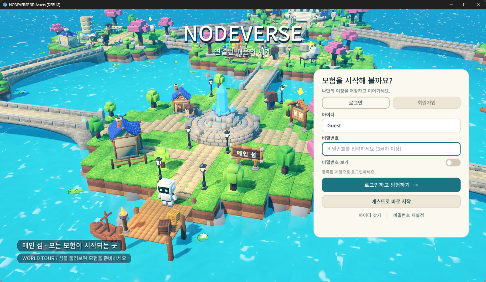
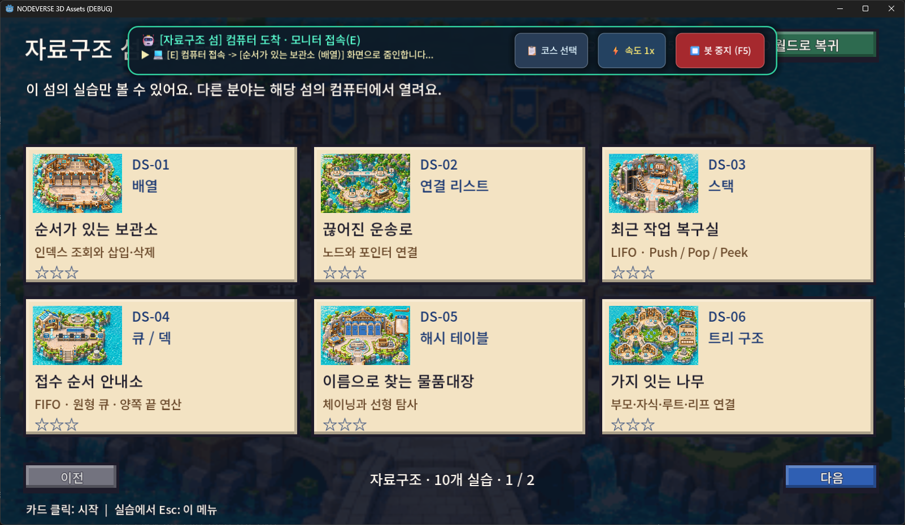
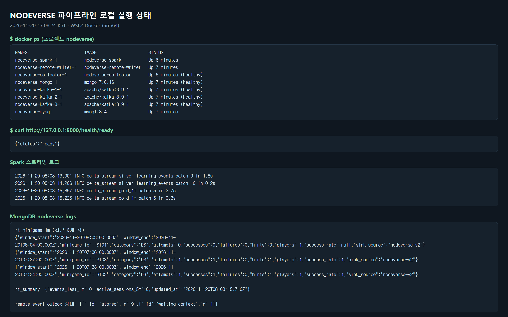
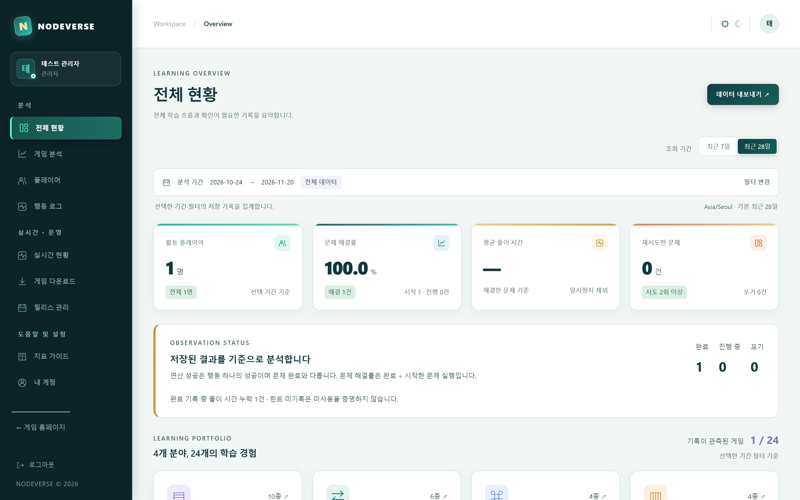
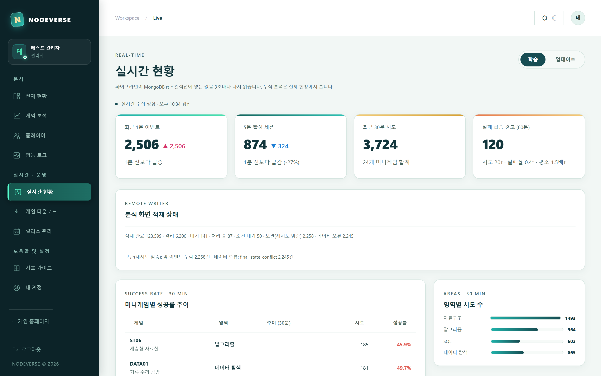
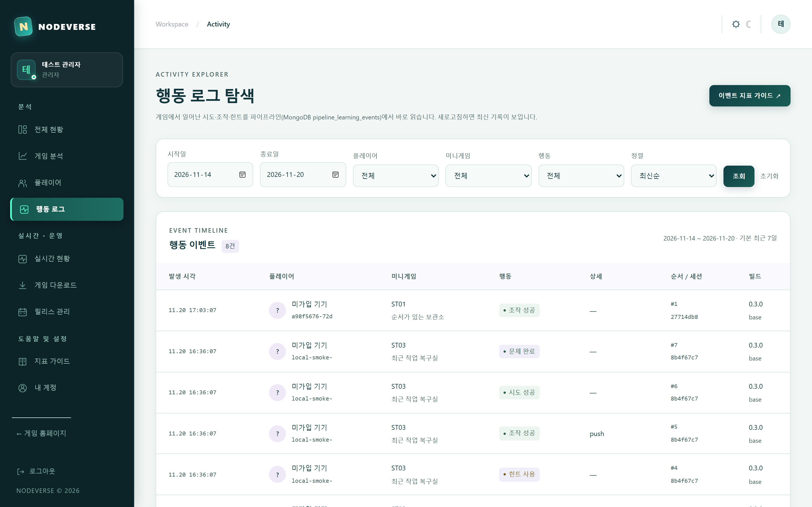
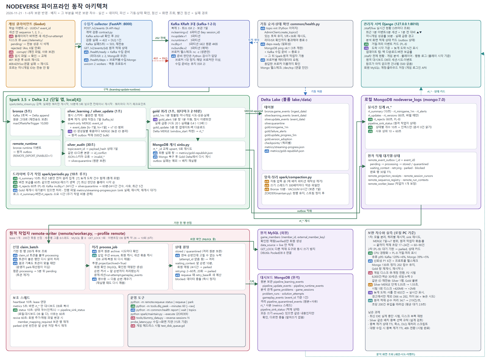
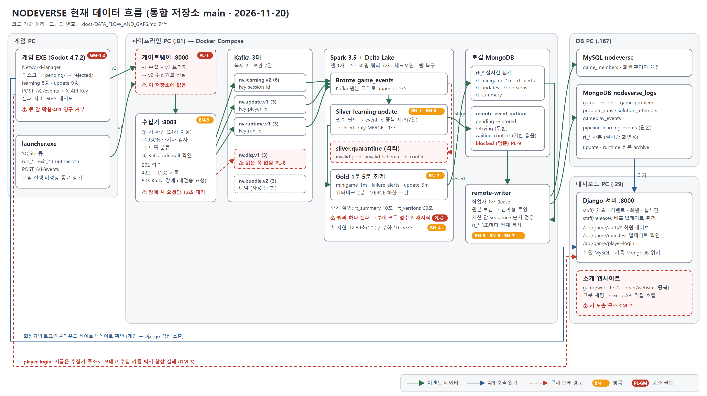

# NODEVERSE — 연결된 배움의 세계

MLO 2기 3차 프로젝트 1팀 통합 저장소입니다.

```bash
git lfs install        # game/ 의 Godot 에셋은 LFS로 받습니다
git clone https://github.com/encore-ai-campus/mlo-02-p3-team1.git
code mlo-02-p3-team1/nodeverse.code-workspace
```

> 처음 받는 사람은 [개발환경 구성 가이드](docs/SETUP_GUIDE.md)부터 보세요. 한 PC에서 전체를 띄우려면 저장소 루트의 **`전체실행.cmd`** 를 더블클릭하세요(중지: `전체중지.cmd`, 상태: `상태확인.cmd`, DB 조회: `DB조회화면.cmd`·`DB조회_몽고.cmd`·`DB조회_MySQL.cmd`, 자세히: [LOCAL_RUN_WINDOWS_ARM.md](docs/LOCAL_RUN_WINDOWS_ARM.md)).

---

## 1. 개요

NODEVERSE는 **자료구조·알고리즘·SQL·데이터 탐색**을 3D 섬 월드와 2D 미니게임으로 배우는 교육용 게임 플랫폼입니다.
플레이어가 게임에서 하는 학습 행동(문제 시작, 조작 성공·실패, 힌트, 시도 결과)을 이벤트로 수집하고,
실시간 파이프라인에서 검증·집계해 관리자 대시보드에서 학습 현황과 어려운 구간을 확인합니다.

| 구성 | 한 줄 설명 |
|---|---|
| 게임 | Godot 4.7 클라이언트. 섬 7개로 된 3D 월드와 미니게임 24종, 학습 이벤트 송신, 회원·클라우드 세이브, 자동 업데이트 |
| 파이프라인 | 수집 API → Kafka → Spark Structured Streaming + Delta Lake(Bronze·Silver·Gold) → MongoDB, 원격 DB 적재 |
| 서버 | Django 관리자 대시보드, 게임 회원·세이브 API, 배포·업데이트 관리, 소개 웹사이트 |

---

## 2. 저장소 구성

게임·파이프라인·서버를 폴더별로 나눈 모노레포입니다.

각 경로의 README에 해당 파트의 실행 방법과 상세 설명이 있습니다.

| 경로 | 내용 | 설명서 |
|---|---|---|
| `game/` | Godot 게임 클라이언트, 소개 웹사이트 원본 | [game/README.md](game/README.md) |
| `pipeline/` | 수집기·Kafka·Spark/Delta·원격 적재 작업자 | [pipeline/README.md](pipeline/README.md) |
| `server/` | Django 대시보드·게임 API | [server/README.md](server/README.md) |
| `contracts/` | 세 파트 공통 이벤트 형식·Kafka 토픽 | [contracts/README.md](contracts/README.md) |
| `docs/` | 팀 공통 문서·보고서·아키텍처 그림 | [docs/README.md](docs/README.md) |

```
mlo-02-p3-team1/
├─ game/        Godot 프로젝트 (바이너리 에셋은 Git LFS)
├─ pipeline/    collector.py · spark/ · remote/ · compose.json · launcher.py
├─ server/      config/ · accounts/ · telemetry/ · templates/ · static/
├─ contracts/   공통 이벤트 규약
├─ docs/        가이드 · 검토 · 보고서 · architecture/
├─ .github/workflows/   폴더별 CI (pipeline·server·game)
└─ nodeverse.code-workspace
```

- 작업 브랜치는 `game/…`, `pipeline/…`, `server/…`, `contracts/…`, `docs/…` 접두어를 쓰고 PR로 `main`에 합칩니다. `contracts/`를 바꾸는 PR은 세 파트 모두 리뷰합니다.
- `.env`·API 키는 절대 커밋하지 않습니다. `.env.example`만 올립니다.

---

## 3. 파트별 개요와 동작 방식

### 3-1. 게임 (`game/`)

| 항목 | 내용 |
|---|---|
| 엔진 | Godot **4.7.2** (웹 빌드는 Compatibility/WebGL2) |
| 메인 씬 | `scenes/NodeverseWorld.tscn` — 메인 섬과 자료구조·알고리즘·SQL·데이터 섬이 다리로 연결된 3D 월드 |
| 미니게임 | 24종 (`scripts/learning_catalog.gd`): DS 10 · ALGO 6 · SQL 4 · DATA 4 |
| 자동 로드 | `NetworkManager`(이벤트 송신·회원 API·F6 디버그 패널), `UpdateManager`(시작 시 업데이트 확인) |
| 내보내기 | `Windows Desktop`(EXE), `Web`, `Content Pack`(.pck 리소스 팩) |

**동작 방식**
1. 로그인하면 Django `/api/game/auth/login`으로 회원을 확인하고 클라우드 세이브를 불러옵니다. 이후 학습 이벤트의 `player_id`는 회원 ID입니다.
2. 미니게임에서 행동이 일어날 때마다 `NetworkManager`가 v2 이벤트를 만들어 **디스크 큐**(`user://telemetry/pending/`)에 먼저 저장합니다.
3. 큐에서 하나씩 `POST /v2/events`로 보냅니다(3초 타임아웃, `X-API-Key`). 202면 삭제, 401·422면 `rejected/`로 옮기고, 그 밖의 오류는 같은 event_id로 1~60초 간격으로 재시도합니다. 네트워크가 없어도 게임은 멈추지 않습니다.
4. 시작할 때 `/api/game/manifest`로 새 버전·리소스 팩을 확인하고 업데이트 이벤트를 보냅니다.
5. 실행·종료 감시는 `launcher.exe`(`pipeline/launcher.py`)가 맡아 `/v1/events`로 보냅니다.

**실행 화면**

| 로비 | 3D 월드 · 테스트 봇(F5) |
|---|---|
|  |  |

자세히: [`game/README.md`](game/README.md), [`game/MINIGAME_GUIDE.md`](game/MINIGAME_GUIDE.md), [`game/docs/`](game/docs/)

### 3-2. 파이프라인 (`pipeline/`)

| 구성 요소 | 역할 |
|---|---|
| `collector.py` (FastAPI) | `POST /v2/events` 단일 이벤트 수집. 키 확인 → 스키마 검사 → 토픽 분류 → Kafka `acks=all` 확인 후 **202**. 잘못된 입력은 **422 + DLQ**, Kafka 장애는 **503** |
| Kafka 3대 | 토픽 5개, 복제 3·최소 ISR 2, 보관 7일 |
| `spark/delta_stream.py` | Spark 앱 1개·스트리밍 쿼리 7개. Bronze(원본 보존) → Silver(검증·중복 제거) → Gold(1분·5분 집계) → MongoDB `rt_*` |
| `remote/` (remote-writer) | Silver를 통과한 이벤트를 outbox에 쌓고, 작업자가 원격 MySQL·MongoDB에 서버가 읽는 형태(세션·문제 실행·시도·이벤트)로 적재 |
| `simulator.py`, `spark/verify.py`, `spark/probe_latency.py` | 계약 점검·부하 시험·행 수 대조·지연 측정 |
| `launcher.py` | 게임 실행기. 실행·하트비트·종료 이벤트를 SQLite 큐에 보관 후 전송 |

**동작 방식과 보장**
- **유실 방지:** 202는 Kafka에 복제·기록된 뒤에만 돌려줍니다. Kafka가 7일 보관하므로 Spark가 멈춰도 재시작하면 체크포인트부터 이어서 처리합니다.
- **중복 방지:** 같은 event_id 재전송은 Silver에서 7일 동안 걸러지고, insert-only MERGE라 다시 실행해도 행이 늘지 않습니다. 같은 ID에 다른 내용이 오면 `silver.quarantine`에 `id_conflict`로 격리합니다.
- **지연:** 이벤트가 대시보드 `rt_*`에 반영되기까지 평시 약 10~18초입니다(구조상 제약, D22).
- **원격 적재:** 회원 매핑이 없거나 세션 순서가 비면 `waiting_context`로 기다리고, 잘못된 데이터는 `blocked`, 일시 오류는 `retrying`으로 둡니다.

**실행 화면**



자세히: [`pipeline/README.md`](pipeline/README.md), [`pipeline/docs/DECISIONS.md`](pipeline/docs/DECISIONS.md), [`pipeline/docs/LIVE_REMOTE_SINK.md`](pipeline/docs/LIVE_REMOTE_SINK.md)

### 3-3. 서버 (`server/`)

| 항목 | 내용 |
|---|---|
| 프레임워크 | Django 5.2, MySQL(회원·관리자·배포) + MongoDB(플레이 기록·실시간 지표) |
| 앱 | `accounts`(관리자 가입·로그인), `telemetry`(분석 화면·게임 API·배포) |
| 관리자 화면 | `/staff/` 개요·게임별·회원별, `/staff/events/`, `/staff/live/`(3초 갱신 실시간), `/staff/releases/` |
| 게임 공개 API | `POST /api/game/auth/{register,login,find-id,reset-password,save}`, `GET /api/game/manifest` |
| 서버 간 API | `POST /api/game/records`, `/api/game/player-login` (`GAME_SERVER_API_KEY`) |

**동작 방식:** 서버는 학습 이벤트를 직접 받지 않습니다. 실시간 화면은 파이프라인이 채운 `rt_*`를 읽고, 분석 화면은 remote-writer가 적재한 `game_sessions`·`problem_runs`·`solution_attempts`·`gameplay_events`·`pipeline_learning_events`를 읽습니다. 게임이 서버를 직접 부르는 것은 회원가입·로그인·세이브·업데이트 확인뿐입니다.

**실행 화면**

| 전체 현황 | 실시간 현황 | 행동 로그 |
|---|---|---|
|  |  |  |

자세히: [`server/README.md`](server/README.md), [`server/docs/`](server/docs/)

### 3-4. 데이터 규약 (공통)

기준은 [`pipeline/contract.py`](pipeline/contract.py)이고 사본이 [`contracts/`](contracts/)에 있습니다. 게임과 파이프라인은 이 규약과 일치합니다.

| 종류 | 토픽 · 파티션 키 | 이벤트 |
|---|---|---|
| 학습 v2 | `nv.learning.v2` · session_id | problem_started, attempt_started, operation_succeeded, operation_failed, hint_used, attempt_succeeded, attempt_failed, problem_completed |
| 업데이트 v2 | `nv.update.v1` · player_id | update_checked·prompted·accepted·dismissed, pack_download_started·succeeded·failed, pack_mounted, build_changed |
| 실행 v1 | `nv.runtime.v1` · run_id | run_started, run_heartbeat, exit_* (근거 evidence 필수) |
| 거부 | `nv.dlq.v1` | 422로 거절된 원문(4KB까지)과 사유 |

학습 이벤트 예시:

```json
{
  "schema_version": 2,
  "event_id": "UUID", "player_id": "회원 ID 또는 설치 ID",
  "session_id": "UUID", "run_id": "UUID", "attempt_id": "UUID (선택)",
  "minigame_id": "ST03", "category": "DS",
  "build_version": "0.3.0", "content_version": "base",
  "event_type": "operation_failed",
  "occurred_at": "2026-11-20T03:40:12.345Z",
  "sequence": 7,
  "details": { "operation": "pop", "failure_reason": "empty_stack", "mistakes": 1 }
}
```

- `occurred_at`은 UTC 밀리초 형식입니다. 5분 넘게 미래면 거절, 6일 넘게 지났으면 `too_old`로 거절합니다.
- `details`에는 허용된 키만(operation, failure_reason, level, moves, mistakes, stars, hint_id, state_before, state_after) 2KB 이하로 넣습니다.
- `minigame_id`와 `category` 조합이 카탈로그와 다르면 거절합니다.
- `sequence`는 세션 안에서 1부터 빠짐없이 증가해야 원격 적재가 진행됩니다.

---

## 4. 종합 구조와 동작 흐름



원본 SVG: [`docs/architecture/pipeline-architecture-2026-11-21.svg`](docs/architecture/pipeline-architecture-2026-11-21.svg) (생성: `python docs/architecture/pipeline_architecture.py`). 보완 전 흐름과 문제 지점은 아래 그림입니다.



원본 SVG: [`docs/architecture/data-flow-2026-11-20.svg`](docs/architecture/data-flow-2026-11-20.svg). 그림의 BN·PL·GM·CM 번호는 [데이터 흐름과 보완 목록](docs/DATA_FLOW_AND_GAPS.md)의 항목입니다.

| 순서 | 위치 | 일어나는 일 |
|---|---|---|
| ① | 게임 PC | 학습 행동 → 이벤트 생성 → 디스크 큐 → `POST /v2/events` |
| ② | 파이프라인 PC (.81) | 게이트웨이 :8000 → 수집기가 검사 후 Kafka에 기록, 202 응답 |
| ③ | 〃 | Spark Bronze(원본) → Silver(검증·중복 제거) → Gold(1분·5분 집계) |
| ④ | 〃 | Gold → 로컬 MongoDB `rt_*`, Silver → outbox |
| ⑤ | 〃 → DB PC (.167) | remote-writer가 MySQL `game_members`, MongoDB 세션·시도·이벤트와 `rt_*` 사본으로 적재 |
| ⑥ | 대시보드 PC (.29) | Django가 MySQL·MongoDB를 읽어 `/staff/` 화면에 표시 |
| ⑦ | 게임 ↔ Django | 회원가입·로그인·클라우드 세이브·업데이트 확인은 직접 호출 |

| PC | 실행하는 것 | 기본 포트 |
|---|---|---|
| 게임 PC | 게임 EXE, launcher.exe | — |
| 파이프라인 PC | 게이트웨이, 수집기, Kafka×3, Spark, 로컬 MongoDB, remote-writer (Docker Compose) | 8000(게이트웨이), 8003(수집기), 27017·27020(Mongo) |
| DB PC | MySQL, MongoDB | 3306, 27017 |
| 대시보드 PC | Django | 8000 |

---

## 5. 추후 예정

남은 항목만 적었습니다. 1~7차 보완에서 처리한 내용은 [변경 리포트](docs/reports/2026-11-20_NODEVERSE_변경리포트.md)와 [구조 비교 자료](docs/presentation/)에, 항목별 근거(파일·줄 번호)는 [docs/DATA_FLOW_AND_GAPS.md](docs/DATA_FLOW_AND_GAPS.md)에 있습니다.

**운영·보안**
- 게이트웨이(:8000 → v2 수집기) 설정을 저장소로 가져오기. 지금은 저장소만으로 운영 경로를 재현할 수 없음 (PL-1)
- Groq 키 폐기, 코봇 채팅을 서버 경유로 변경. 공용 저장소 기록에서는 키를 지웠음 (CM-1, CM-2)
- 수집기 동시 처리 제한 (PL-3의 남은 부분)
- DLQ에 쌓인 이벤트를 원인 수정 후 다시 넣는 재처리 스크립트 (PL-8의 남은 부분)
- 모든 PC 시간 동기화(NTP) 확인 (CM-4)

**성능 (대량 수집 대비)**
- 원격 작업자 다중 프로세스: 지금 초당 약 200건까지 따라감. 그 이상이 계속되면 세션 단위로 나눠 프로세스 확장
- 대량 수집 단계에서 중복 제거 상태 TTL을 48시간으로 (`DEDUP_TTL_HOURS`, 기존 체크포인트 호환 시험 완료)

**게임**
- 수집기·서버 주소를 코드 기본값 대신 설정으로 받기 (GM-6)
- 최신 EXE로 실제 종단 시험(강제 종료·재실행·계정 전환 포함), 실제 디스크 부족 재현

**구조 정리**
- Spark 처리 로직 단위 테스트, 흩어진 시험 스크립트 정리 (RF-9, RF-10)
- `contracts/`를 단일 기준으로 만들고 서버의 옛 스키마 정리 (CM-5, SV-3)
- 서버·게임 CI를 실제 테스트로 확장 (SV-4)
- `game/website`와 `server/website` 중복 정리
- 파이프라인 진행 현황판(실시간 현황의 파이프라인 탭): 요청 검토 완료, 보류

---

## 문서 모음

| 문서 | 내용 |
|---|---|
| [docs/HANDOFF_2026-11-23.md](docs/HANDOFF_2026-11-23.md) | 공용 저장소 인계 정리: 파트별 바뀐 것·읽을 문서·남은 일 |
| [docs/SETUP_GUIDE.md](docs/SETUP_GUIDE.md) | clone 후 파트별 개발환경 다시 구성하기 |
| [docs/DATA_FLOW_AND_GAPS.md](docs/DATA_FLOW_AND_GAPS.md) | 데이터 흐름, 병목, 보완·추가 구현 목록 |
| [docs/INTEGRATION_REVIEW_2026-11-20.md](docs/INTEGRATION_REVIEW_2026-11-20.md) | 세 파트 연동 검토 |
| [docs/reports/](docs/reports/) | 중간보고서, 델타레이크 오류수정내역, 로그인·클라우드세이브 정리 |
| [docs/presentation/](docs/presentation/) | 파이프라인 처음 구조·현재 구조·최적화(1~8차) 비교 PDF와 발표용 그림 6장 (16:9 PNG·SVG) |
| [contracts/README.md](contracts/README.md) | 공통 이벤트 규약과 남은 차이 |
