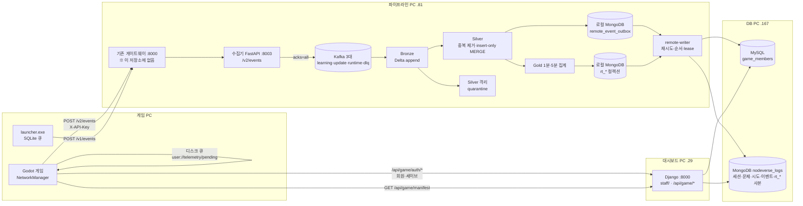
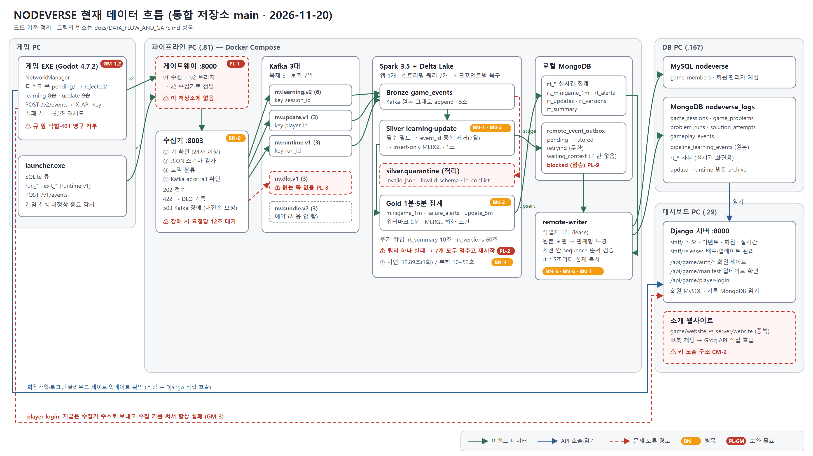

# 데이터 흐름과 보완·추가 구현 목록

기준: 통합 저장소 `main` (2026-11-20 16:00 KST, 게임 88394b1 · 파이프라인 32b0248 · 서버 3dfece8).
코드를 읽고 정리한 결과이며 전체 스택을 이 PC에서 실행해 확인한 것은 아닙니다. 줄 번호는 이 시점 기준입니다.

---

## 1. 전체 데이터 흐름

### 단계별 요약

| 단계 | 하는 일 | 실패 시 동작 (현재 코드) |
|---|---|---|
| 게임 송신 `game/scripts/network_manager.gd` | 이벤트를 디스크 큐에 저장 후 하나씩 POST, 3초 타임아웃 | 401·422 → `rejected/`로 옮기고 재전송 안 함. 그 밖의 오류 → 같은 event_id로 1~60초 지수 백오프 재시도 |
| 수집기 `pipeline/collector.py` | 키 확인 → JSON·스키마 검사 → 토픽 분류 → Kafka 전송 확인 후 202 | 잘못된 입력 → 422 + DLQ 토픽 기록. Kafka 실패 → 503(같은 본문으로 재전송 요청). 16KiB 초과 → 413 |
| Bronze `spark/delta_stream.py` | Kafka 원본을 그대로 Delta에 추가 | 체크포인트로 재시작 시 이어서. Kafka에서 지워진 오프셋이 있으면 중단(`failOnDataLoss=true`) |
| Silver | 필수 필드 확인, event_id 7일 중복 제거, insert-only MERGE, outbox 적재 | 같은 batch 재실행해도 행이 늘지 않음. 같은 ID·다른 내용은 격리 |
| Gold | 1분·5분 집계 후 Delta MERGE + Mongo `rt_*` upsert | Mongo upsert 실패 시 해당 쿼리 실패 → 앱 전체 종료 → 컨테이너 재시작 |
| remote-writer `pipeline/remote/worker.py` | outbox에서 하나씩 꺼내 원격 Mongo·MySQL에 관계형 문서로 적재, `rt_*` 5초마다 복사 | 일시 오류 → `retrying`(최대 60초 간격, 무한). 회원 매핑 없음 → `waiting_context`. 데이터 오류 → `blocked`(멈춤) |
| 서버 `server/telemetry/` | 원격 Mongo의 `rt_*`(실시간)와 세션·이벤트(분석)를 화면에 표시 | Mongo 접속 실패 시 화면 오류 |

---

(원본 SVG: `docs/architecture/data-flow-2026-11-20.svg`)

---

## 2. 병목 구간 (데이터가 쌓이거나 부하가 걸릴 때 느려지는 곳)

| # | 구간 | 코드가 보여 주는 것 | 영향 | 개선 방향 |
|---|---|---|---|---|
| BN-1 | **Silver insert-only MERGE** (D23) | 조건이 `t.event_id = s.event_id` 하나뿐입니다(`delta_stream.py` 152행). Silver는 `event_date`로 파티션되어 있지만 조건에 날짜가 없어 파티션을 건너뛰지 못하고, event_id는 무작위 UUID라 파일별 최소·최대 통계로도 거의 걸러지지 않습니다. 배치(1초 트리거)마다 Silver 전체의 event_id를 읽는 구조입니다 | Silver가 커질수록 배치 시간이 선형으로 늘어납니다. D19에서 피하려던 바로 그 구조이며, D23 메모에도 "D19의 성능 설명은 현재 코드에 적용되지 않는다"고 적혀 있습니다 | MERGE 조건에 이번 배치의 `event_date` 범위(앞뒤 하루 여유)를 추가하거나, 상태 저장소 중복 제거가 이미 7일을 보장하므로 txn append(D19)로 되돌릴지 요구사항 4와 함께 재검토 |
| BN-2 | **Gold MERGE 하한 조건** (D21) | `t.window_start >= 배치 최소값`이라는 하한 조건으로 오래된 파일을 통계로 건너뜁니다(`delta_stream.py` 245~255행). 하지만 Gold 테이블은 파티션이 없고, 1분마다 작은 파일이 계속 추가됩니다 | 건너뛰기는 되지만 Delta 로그의 파일 목록 자체가 계속 늘어서, 읽어야 할 파일 통계와 로그 재생 비용이 시간에 따라 증가합니다. 경고 기준선 조회(30분 전부터)도 같은 영향을 받습니다 | `maintain.py`의 OPTIMIZE를 정기 실행(지금은 writer를 멈춰야 하는 수동 절차), 또는 Gold를 날짜 파티션으로 |
| BN-3 | **작은 파일 누적** | Silver·Gold가 1초 트리거로 커밋합니다(`STAGE_TRIGGER=1 second`). 이벤트가 있는 동안 테이블마다 하루 최대 8만 번 넘게 커밋할 수 있습니다 | 파일 수와 `_delta_log` 크기가 늘어 BN-1·BN-2를 더 악화시킵니다 | 트리거 간격 조정(지연과 맞교환), 자동 compaction 설정 검토, 정기 OPTIMIZE |
| BN-4 | **지연 측정 근거 부족** | 11/16 클라우드 시험: 4코어에 Kafka 3대·Spark·Mongo·수집기·부하기를 함께 돌려 CPU가 포화(부하 평균 7~8)된 상태에서 평시 9~18초, 초당 200건 부하 중 10~53초. 그 뒤 현재 설정으로는 로컬에서 **12.89초 1회**만 측정 (`pipeline/docs/DELTA_REQUIREMENTS_REVIEW_2026-11-20.md` 172행) | 15초 목표(P4)를 부하 상태에서 만족하는지 아직 모릅니다. BN-1이 있으므로 데이터가 쌓인 뒤에는 더 느려질 가능성이 큽니다 | Docker 설치 후 이 PC(20코어)에서 `probe_latency.py`를 평시·부하·데이터 누적(예: 100만 건) 상태로 각각 반복 측정 |
| BN-5 | **원격 적재 작업자가 한 건씩 직렬 처리** | 작업자는 lease로 하나만 돌고, 이벤트마다 원격 원본 저장, MySQL 새 연결 + `GET_LOCK`, 여러 번의 find_one, outbox 갱신을 차례로 합니다(`remote/worker.py` 99~131행) | LAN 왕복을 고려하면 처리량이 초당 수십 건 수준으로 제한될 가능성이 있습니다. 부하 시험의 초당 200건이 들어오면 outbox가 계속 쌓이고 대시보드 분석 화면이 점점 뒤처집니다. 수집·Silver는 영향 없음 | 처리량 실측, MySQL 연결 재사용, 세션별 병렬 처리(같은 세션 안의 순서는 유지) |
| BN-6 | **순서 대기로 세션 전체 정지** | 세션 안 `sequence`가 하나라도 비면 다음 이벤트부터 `waiting_context: sequence_gap`으로 대기합니다(`remote/projection.py` 122행). 게임에서 이벤트 하나가 `rejected/`로 빠지면(GM-1·GM-2) 그 세션의 나머지는 영원히 적재되지 않습니다 | 분석 화면에서 해당 세션이 중간에 끊긴 것으로 보입니다 | 빠진 번호에 기한을 두고 건너뛰기 표시, 게임의 rejected 처리와 함께 설계 |
| BN-7 | **지표 복사가 시간에 따라 느려짐** | `mirror_metrics`가 5초마다 로컬 `rt_*` 전체를 읽어 원격에 한 건씩 씁니다(`remote/worker.py` 50행). `rt_minigame_1m`은 1분마다 미니게임 수만큼 늘어납니다. 이 작업이 이벤트 적재와 같은 루프에서 돌아 BN-5를 더 느리게 만듭니다 | 운영 기간이 길수록 원격 대시보드의 실시간 값과 분석 데이터 모두 늦어집니다 | 변경분(`updated_at`)만 복사, bulk_write, 별도 스레드 |
| BN-8 | **Silver 배치 안의 outbox 적재** | Silver MERGE 직후 드라이버에서 이벤트마다 Mongo 왕복 2회로 outbox에 넣습니다(`remote/outbox.py` 25행) | 부하 시 Silver 배치 시간이 늘어 Gold·대시보드 지연(BN-4)에 더해집니다 | bulk upsert로 묶기 |
| BN-9 | **수집기 스레드 점유** | Kafka 응답을 최대 12초 기다리는 동안 스레드 하나를 잡습니다(PL-3) | Kafka가 느려지면 수집 API 전체가 느려집니다 | 대기 시간 단축, 동시 처리 제한 |

### 2-1. 로컬 실측 (2026-11-20, 이 PC)

환경: Windows 11 ARM64(20코어) · WSL2 Docker · `전체실행.cmd`로 띄운 기본 설정(Spark 4코어, 드라이버 2GB, Bronze 5초·Silver/Gold 1초 트리거, 원격 적재 켬).
부하: 시험 송신기(동시 32개)로 학습 이벤트 24,000건 + 18,000건을 각각 초당 약 175건으로 전송. 끝난 시점 Silver 약 4.2만 행.

| 측정 | 결과 | 판단 |
|---|---|---|
| 수집 API 응답 | 4.2만 건 중 99.8%가 202, p50 25ms · p95 37ms | 정상 |
| 수집 API 지연 꼬리 | 약 0.2%(92건)가 20초 넘게 응답 없음 → 클라이언트 타임아웃. 서버 로그에는 모두 202로 기록됨 | 늦게라도 접수는 됐으므로 재전송하면 중복으로 걸러짐. 원인 미확정(Kafka 전송 대기 12초 + 스레드 풀 대기 또는 WSL 네트워크) → BN-9 확인 필요 |
| 반영 지연 (이벤트 → `rt_minigame_1m`) | 평시 5.3~9.1초 (3회), 초당 177건 부하 중 8.6~12.1초 (5회) | **15초 목표 통과.** 11/16 클라우드 수치(10~53초)는 CPU 포화 탓이었음이 확인됨 (BN-4 해소) |
| Silver learning 배치 시간 | 평균 3.2~3.3초, 최대 7.1초 (부하 중) | 1초 트리거보다 길어 배치가 밀려 있음. 시간 대부분이 MERGE 뒤 outbox 적재(이벤트당 Mongo 왕복 2회) |
| Silver 행 수 증가에 따른 변화 | 2.4만 → 4.2만 행 구간에서 평균 3.34초 → 3.22초 (변화 없음) | 이 규모에서는 BN-1이 아직 드러나지 않음. 수십만~백만 행에서 다시 재야 함 |
| Gold 1분 배치 | 평균 1.4~1.5초, 최대 5.4초 | 여유 있음 |
| **원격 적재 처리량** | **초당 약 17~24건** (152초 동안 2,639건 처리). 부하 종료 시 outbox 대기 **35,230건**, 다 비우는 데 약 30분 이상 | **가장 큰 병목 (BN-5 확인).** 유입(초당 175건)의 약 1/8만 처리. 대시보드 분석 화면이 실시간에서 수십 분 뒤처짐 |

### 2-1-1. 개선 적용 후 재측정 (2026-11-20 17:36~17:47 KST)

적용: 원격 적재 작업자에 MySQL 연결 풀(DBUtils `PooledDB`, 8개) · 전역 잠금을 전용 연결 하나로 유지 · 200건 묶음 가져오기 + 세션별 병렬(스레드 8개, 세션 안 순서 유지) · 지표 복사 별도 스레드·변경분만 · Silver outbox 묶음 쓰기 · Silver MERGE 날짜 범위 조건.

| 측정 | 개선 전 | 개선 후 |
|---|---|---|
| 원격 적재: 회원 매핑 대기로 끝나는 이벤트 처리 | 초당 17~24건 | **초당 248건** (대기 2.2만 건을 90초에 소화) |
| 원격 적재: 세션·시도·이벤트 문서까지 끝까지 적재 | 측정 불가(뒤처짐) | **초당 약 55~70건** (유입 초당 147건 부하 중 57건, 부하 후 약 70건) |
| Silver 배치 중 outbox 적재 시간 | 배치 대부분 차지(추정) | **평균 0.37초** |
| Silver 배치 중 MERGE 시간 (Silver 약 7~8만 행) | — | 평균 3.75초 (전체 4.19초, 최대 7.9초) |
| 단위 테스트 | 48개 | 51개 통과 (묶음 가져오기·세션 묶기·outbox 묶음 쓰기 테스트 추가) |

남은 과제:
- **끝까지 적재 경로는 아직 유입보다 느립니다(초당 55~70 vs 147).** 이벤트 하나에 Mongo 조회·쓰기가 10번 안팎(`projection.py` `ensure`·`find_one` 연쇄)이라, 다음 단계는 세션 단위로 커서·실행 문맥을 메모리에 두고 쓰기를 묶는 것입니다. 스레드 수(`REMOTE_WORKERS`)를 늘리는 것도 바로 시험해 볼 수 있습니다.
- **Silver MERGE가 이제 Silver 배치의 대부분입니다.** 날짜 범위 조건은 날짜가 바뀌어 데이터가 쌓일 때 효과가 있고, 같은 날 안에서는 그날 파티션 전체를 읽습니다. 하루 데이터가 커지면 다시 느려지므로, 상태 저장소 중복 제거를 믿고 MERGE 대신 txn append(D19)로 되돌리거나 event_id 블룸 필터·Z-order를 검토해야 합니다.
- 부하 시험 데이터에서 `final_state_conflict` 2,245건이 `blocked`로 나왔는데, 시험 송신기가 한 시도에 실패·성공을 둘 다 보내는 비현실적인 순서를 만들어서 생긴 것입니다(코드 문제 아님). `sequence_gap` 대기도 시험 송신기의 빠른 연속 전송 탓이 크며 앞 번호가 처리되면 자동으로 풀립니다.

### 2-1-2. 리팩토링 후 더미 데이터 3만 건 시험 (2026-11-20 18:00 KST)

`tools/dummy_data.py`로 게임 규칙을 지키는 더미 세션 2,965개(이벤트 30,013건, 회원 1,200명)를 초당 약 185건으로 전송.

| 측정 | 결과 |
|---|---|
| 수집 | 30,013건 전부 202, p50 23ms · p95 37ms |
| 반영 지연 (`rt_minigame_1m`) | 최대 11.1초 → 15초 목표 통과 |
| Spark | 쿼리 8개 모두 정상, MongoDB 쓰기 실패 0, 쿼리 재시작 0 |
| 원격 적재 (끝까지) | 약 8분 안에 29,900건 이상 `stored`, `blocked` 0건. 평균 초당 약 60건, 최대 초당 약 90건 |

이번 단계에서 고친 것: 한 세션의 이벤트가 대기하면 같은 세션의 뒤 이벤트를 각자 백오프로 실패시키지 않고 함께 대기열로 돌려보냄(`process_group`), 더미 데이터가 문제마다 run_id를 새로 쓰도록 수정(이전 시험의 `blocked`는 시험 데이터가 원인).
남은 과제: 끝까지 적재는 여전히 유입(초당 150~185건)보다 느려 부하가 길게 이어지면 밀림 → 투영 코드의 이벤트당 Mongo 왕복 축소가 다음 단계.

### 2-2. 병목별 개선안 (우선순위 순)

**① 원격 적재 작업자 (BN-5·BN-7, 실측으로 확인, 효과 가장 큼)**
- 원인: `remote/worker.py`가 한 번에 한 건만 꺼내고(`claim`, 33행), 이벤트마다 MySQL 새 연결 + `GET_LOCK`(118~122행), 원격 Mongo 원본 저장, 여러 번의 `find_one`(`projection.py` 121~191행), outbox 갱신을 차례로 합니다. 5초마다 `rt_*` 전체 복사(`mirror_metrics`, 50행)도 같은 루프에서 돕니다.
- 개선:
  1. MySQL 연결을 작업자 시작 시 한 번 열고 재사용, 회원 조회는 메모리 캐시 (예상: 건당 수십 ms 절감)
  2. outbox를 100건 단위로 가져와 세션별로 묶고, 세션 안 순서는 지키되 세션끼리는 병렬(스레드 4~8개) 처리
  3. 원격 Mongo 쓰기를 `bulk_write`로 묶기
  4. `mirror_metrics`를 별도 스레드로 빼고 `updated_at` 이후 변경분만 복사
- 목표: 초당 200건 이상. 검증: 이 문서의 부하 시험을 그대로 다시 실행해 outbox 대기 건수가 늘지 않는지 확인.

**② Silver 배치 안의 outbox 적재 (BN-8, 실측으로 확인)**
- 원인: Silver MERGE 직후 드라이버가 `toLocalIterator()`로 행을 하나씩 돌며 `find_one` + `update_one`(`outbox.py` 25~41행) → 배치당 수백~수천 번 왕복.
- 개선: `UpdateOne(..., upsert=True)` 목록을 만들어 `bulk_write(ordered=False)` 한 번으로. payload_hash 충돌 확인은 `$setOnInsert` 후 결과의 hash 비교로 대체. 또는 outbox 적재를 별도 스트리밍 쿼리로 분리해 대시보드 경로(Silver→Gold)와 떼어 놓기.
- 기대: Silver 배치 3.2초 → 1초 안팎, 반영 지연 2~3초 단축.

**③ Silver MERGE 전체 스캔 (BN-1, 코드상 확실·규모가 커지면 드러남)**
- 원인: `delta_stream.py` 152행 조건 `t.event_id = s.event_id`에 파티션 열(`event_date`)이 없음.
- 개선: 배치의 `event_date` 최소·최대를 구해 `AND t.event_date BETWEEN lo - 1일 AND hi + 1일`을 조건에 추가. 상태 저장소가 이미 7일 중복 제거를 보장하므로 범위 밖 중복은 생기지 않음.
- 검증: 100만 행까지 쌓은 뒤 배치 시간 비교.

**④ 작은 파일·Gold 로그 증가 (BN-2·BN-3)**
- 개선: `delta.autoOptimize.optimizeWrite`/`autoCompact` 테이블 속성 검토, 또는 하루 한 번 `maintain.py --execute`를 쓰기 중지 없이 돌 수 있도록(날짜 파티션 단위 OPTIMIZE) 바꾸기.

**⑤ 수집 API 지연 꼬리 (BN-9·PL-3)**
- 개선: Kafka 전송 대기 12초 → 3초, 실패 시 즉시 503; uvicorn `--limit-concurrency` 설정; 응답 시간 로그 추가 후 20초 넘는 요청 원인 확정.

**⑥ 세션 순서 대기 (BN-6)**
- 개선: `sequence_gap` 대기에 기한(예: 10분)을 두고, 넘으면 빈 번호를 표시한 채 다음으로 진행.

---

## 3. 보완·추가 구현 목록

우선순위: **P0** 시연·운영 전에 꼭 필요 / **P1** 안정 운영에 필요 / **P2** 품질 개선.

### 파이프라인 — 예외 처리와 동작

| # | 우선 | 문제 | 근거 | 제안 |
|---|---|---|---|---|
| PL-1 | P0 | **실제 운영 경로의 게이트웨이 코드가 저장소에 없음.** 게임은 `.81:8000` 게이트웨이로 보내고 게이트웨이가 v2 수집기(8003)로 넘기는데, 이 구성(`pipeline/compose.yaml`, `compose.v2-bridge.yaml`, `outputs/compose.lan.yaml`)은 NVG 저장소의 옛 `pipeline/`과 개인 출력 폴더에 있음 | `pipeline/docs/LIVE_REMOTE_SINK.md` 9·74행 | 게이트웨이를 v2 수집기로 대체하거나, 브리지 설정을 `pipeline/gateway/`로 가져와 저장소만으로 재현 가능하게 |
| PL-2 | P0 | **Spark 쿼리 하나가 실패하면 7개 쿼리가 모두 멈춤.** `awaitAnyTermination()` 후 앱이 끝나고 Docker가 재시작. 원격이 아닌 로컬 Mongo가 잠깐 끊겨도 Gold·outbox 단계 예외로 Bronze 수집까지 함께 멈추고, Mongo가 계속 죽어 있으면 재시작이 반복됨(데이터는 Kafka 7일 보관으로 보존) | `delta_stream.py` 155·219·478행 | Mongo 쓰기를 별도 재시도(백오프) 또는 실패 기록 후 다음 배치로 넘기기, Bronze를 별도 앱으로 분리, 재시작 횟수 모니터링 |
| PL-3 | P0 | **수집기가 Kafka 장애 때 요청마다 최대 12초씩 스레드를 잡음.** 기본 스레드 풀(약 40개)이 차면 정상 요청과 `/health`까지 응답이 늦어짐 | `collector.py` 54·134행 | 전송 대기 시간을 줄이고(2~3초), 동시 처리 수 제한 + 빠른 503 반환, producer 큐 가득 참(BufferError) 별도 처리 |
| PL-4 | P1 | `_poll_forever` 스레드에 예외 처리가 없음. 이 스레드가 죽으면 전송 확인 콜백이 오지 않아 모든 요청이 12초 후 503 | `collector.py` 49행 | try/except로 감싸고 죽으면 재시작, `/health/ready`에서 확인 |
| PL-5 | P1 | 본문 크기 확인 전에 전체를 메모리로 읽음 | `collector.py` 105행 | `Content-Length` 먼저 확인, 스트리밍으로 16KiB에서 중단 |
| PL-6 | P1 | `GET /v2/events/{id}`는 로컬 Mongo가 죽으면 처리되지 않은 500 | `collector.py` 168행 | 503과 사유 반환 |
| PL-7 | P1 | `/health/ready`가 Kafka 연결만 보고 토픽 5개 존재·Mongo·Spark 진행 여부는 보지 않음 | `collector.py` 146행 | 토픽 확인, Spark 마지막 배치 시각을 `rt_summary`로 노출 |
| PL-8 | P1 | **(2026-11-20 3차 보완에서 표시·확인 도구 추가, 재처리 스크립트는 남음)** **DLQ를 읽는 쪽이 없음.** 422 이벤트는 `nv.dlq.v1`에 쌓이기만 하고 확인·재처리 수단이 없음. Silver 격리(`silver.quarantine`)도 마찬가지 | `collector.py` 69행, `delta_stream.py` 219행 | DLQ·격리 건수와 사유를 `rt_summary`나 서버 화면에 표시, 재처리 스크립트 |
| PL-9 | P1 | outbox의 `blocked`(데이터 오류)는 영구 정지, `retrying`은 무한 재시도, `waiting_context`(회원 매핑 대기)는 기한 없음. 알림도 없음 | `remote/worker.py` 132~146행 | 상태별 건수를 서버 화면에 노출, 최대 시도 횟수·기한 후 `blocked`로, 재처리 명령 제공 |
| PL-10 | P1 | outbox·conflict 컬렉션이 계속 커짐(정리 없음) | `remote/outbox.py` | `stored` 후 N일 지난 문서 TTL 인덱스 |
| PL-11 | P1 | `mirror_metrics`가 5초마다 `rt_*` 전체를 읽어 원격에 하나씩 씀. `rt_minigame_1m`은 1분마다 미니게임 수만큼 늘어나므로 시간이 갈수록 느려지고, 이 루프가 느리면 이벤트 적재도 같이 밀림 | `remote/worker.py` 50행 | `updated_at` 이후 변경분만 복사, bulk_write, 이벤트 처리와 다른 스레드로 분리 |
| PL-12 | P1 | outbox 적재가 이벤트마다 Mongo 왕복 2회, 원격 적재는 이벤트마다 MySQL 새 연결. 부하 시 Silver 배치 지연과 적재 지연의 원인 | `remote/outbox.py` 25행, `remote/worker.py` 118행 | bulk upsert, MySQL 연결 재사용(풀) |
| PL-13 | P1 | Gold 집계 워터마크 2분: 2~5분 늦게 도착한 이벤트(게임 오프라인 큐 재전송 등)는 실시간 집계에서 빠지고, 5분 넘게 늦으면 도착 시각 기준으로 엉뚱한 창에 들어감(Silver에는 정상 보존) | `delta_stream.py` 37·314행 | 의도한 동작인지 팀 합의 후 문서화, 필요하면 Silver 기준 일별 재집계 배치 |
| PL-14 | P1 | Kafka 보관 7일 + `failOnDataLoss=true`: 파이프라인이 7일 넘게 꺼져 있으면 Bronze가 시작되지 않음 | `delta_stream.py` 75행 | 복구 절차(체크포인트 재설정) 문서화 |
| PL-15 | P2 | 수집기에 요청 로그·지표가 없음(401·422·503 건수, 지연) | `collector.py` | 구조화 로그, 간단한 카운터 엔드포인트 |
| PL-16 | P2 | 인증 실패·대량 요청 제한 없음 | `collector.py` 89행 | IP별 속도 제한, 401 로그 |
| PL-17 | P2 | Delta `lake` 볼륨·체크포인트 백업 절차 없음 | `build_compose.py` | 정기 스냅샷 또는 백업 스크립트 |

### 게임

| # | 우선 | 문제 | 근거 | 제안 |
|---|---|---|---|---|
| GM-1 | P0 | **전송 큐 막힘.** 항상 큐 맨 앞 이벤트부터 보내므로, 그 이벤트가 401·422 이외 오류(413 본문 초과, 400, 404 등)를 계속 받으면 뒤의 모든 이벤트가 영원히 대기 | `network_manager.gd` 731·828행 | 4xx는 `rejected/`로 보내고 5xx·네트워크 오류만 재시도 |
| GM-2 | P0 | **401(키 오류)을 받은 이벤트를 영구 거부 처리.** 키 설정만 틀려도 그동안의 학습 기록이 모두 `rejected/`로 가고 키를 고친 뒤에도 다시 보내지 않음 | `network_manager.gd` 828행 | 401이면 전송을 멈추고 pending에 남겨 두기, 설정 변경 시 재개 |
| GM-3 | P0 | `player-login`이 수집기 주소로, 수집 키를 Bearer로 보냄 → 항상 실패 | `network_manager.gd` 244행 | Django 주소로, 클라이언트용 인증 방식으로 변경 또는 호출 제거(게임이 이미 회원 ID를 player_id로 보냄) |
| GM-4 | P1 | 6일 넘은 이벤트를 보내지 않는 규칙(파이프라인 README·D20)이 게임에 없음. 수집기에서 422 `too_old`로 거절되어 결국 `rejected/` | `network_manager.gd` (해당 로직 없음) | 전송 전 나이 확인 후 만료 처리 |
| GM-5 | P1 | 알 수 없는 미니게임 ID를 `ST01/DS`로 바꿔 보냄 → 배열 실습 통계 오염 | `network_manager.gd` 300~310행 | 전송하지 않고 로그 |
| GM-6 | P1 | 수집기·Django IP가 코드 기본값에 고정(`192.168.0.81`, `.29`) | `network_manager.gd` 30·33행 | 서버 manifest에서 주소 받기 또는 설치 시 설정 |
| GM-7 | P1 | `hint_step`을 보내지 않아 서버 화면에 "단계 None" 표시 | `LIVE_REMOTE_SINK.md` 남은 제한 5 | 송신 규약에 넣거나 화면에서 결측 처리 |
| GM-8 | P2 | 실행·종료 이벤트(run_*, exit_*)는 런처만 보냄. 게임 EXE를 런처 없이 실행하면 비정상 종료 통계가 비어 있음 | `pipeline/launcher.py` | 배포 시 런처 경유 실행 강제 또는 게임 내 최소 이벤트 |
| GM-9 | P2 | **테스트 봇(F5) 전체 코스가 첫 컴퓨터에서 멈춤.** 메인 섬에서 봇이 `world._on_interact()`를 무조건 호출하는데, 로봇이 컴퓨터 근처에 있으면 2D 메뉴로 전환되며 3D 월드가 트리에서 빠집니다. 봇은 이를 확인하지 않고 빠진 월드를 계속 조작하다가, `await world._open_computer_game()`에서 트리 밖 노드의 트윈을 기다리며 영원히 멈춥니다(로그: `!is_inside_tree()` 오류 연속) | `live_test_bot_overlay.gd` 610·450행, `nodeverse_world.gd` 3888·1478행 | 각 단계 전에 월드가 `is_inside_tree()`인지 확인, `_on_interact` 대신 의도한 동작만 직접 호출, 대기에 시간 제한 |

### 서버

| # | 우선 | 문제 | 근거 | 제안 |
|---|---|---|---|---|
| SV-1 | P1 | outbox 상태(`waiting_context`, `blocked`, `retrying`)와 DLQ 건수를 볼 화면이 없음 | — | `staff/live`에 파이프라인 상태 카드 추가 (PL-8, PL-9와 함께) |
| SV-2 | P1 | `recovery_key` 평문 저장 | `server/telemetry/game_auth_api.py` 134행 | 해시 저장 |
| SV-3 | P2 | `server/docs/contracts/behavior-event.schema.json`이 옛 초안 | `contracts/README.md` | 삭제하고 `contracts/`를 참조 |
| SV-4 | P2 | CI가 문법 검사뿐 | `.github/workflows/server.yml` | MySQL·Mongo 서비스 컨테이너로 `manage.py test` |

### 공통·보안

| # | 우선 | 문제 | 제안 |
|---|---|---|---|
| CM-1 | P0 | Groq 키 폐기, 원본 저장소 Archive | 담당자 처리 |
| CM-2 | P0 | 코봇 채팅이 브라우저에서 Groq 직접 호출(`game/website/cobot-chat.js`, `server/website/`) | Django 프록시 엔드포인트 |
| CM-3 | P1 | 수집 키가 게임 클라이언트에 들어가는 구조(설치별 토큰 P7 전까지 알려진 제약) | 설치별 토큰 발급, 그 전까지 속도 제한 |
| CM-4 | P1 | 네 PC의 시간이 어긋나면 `occurred_at` 미래 5분 초과 거절·창 오배치 | 모든 PC NTP 동기화 확인 |
| CM-5 | P2 | 이벤트 계약이 `pipeline/contract.py`, `contracts/`, 서버 스키마 세 곳 | `contracts/`를 단일 기준으로, 파이프라인이 import |
| CM-6 | P2 | 웹 대시보드 체험 암호 `nd1234`(클라이언트 비교) | 데모 전용 표시 또는 제거 |

---

## 4. 파이프라인 코드 리팩토링 검토

규모: Python 약 3,000줄(`spark/` 900, `remote/` 400, 수집기·계약 400, 시험·도구 1,300). 테스트는 수집기 21개, 원격 투영 14개, 런처·시뮬레이터 6개이고 Spark 처리 로직에는 단위 테스트가 없습니다.
우선순위 **상**은 병목 개선이나 장애 대응을 하려면 먼저 해야 하는 것, 노력은 S(반나절) · M(1~2일) · L(3일 이상)입니다.

| # | 우선 | 노력 | 분류 | 현재 | 제안 |
|---|---|---|---|---|---|
| RF-1 ✅ | 상 | M | 모듈 경계 | `spark/delta_stream.py` 484줄 한 파일에 Bronze·Silver·감사·Gold 3종·주기 작업·원격 내보내기·`main`이 모두 있고, 모듈을 import하는 순간 SparkSession이 만들어짐(전역 `spark`) | `bronze.py`·`silver.py`·`gold.py`·`sinks/mongo.py`·`app.py`로 나누고 SparkSession은 `main()`에서 만들어 함수 인자로 전달 → foreachBatch 함수를 로컬 Spark로 단위 테스트 가능 |
| RF-2 ✅ | 상 | M | 예외 처리 | 쿼리 하나 실패 = 앱 전체 종료(`awaitAnyTermination`), Mongo 쓰기 실패는 그대로 예외 | 싱크 쓰기를 `with_retry(fn, attempts, backoff)` 헬퍼로 감싸고, 최종 실패는 실패 기록 컬렉션에 남기고 배치는 통과. 쿼리별 재시작 감시 루프(PL-2) |
| RF-3 ✅ | 상 | M | 모듈 경계 | `remote/worker.py`의 `main()` 하나가 lease·복구·지표 복사·작업 처리·상태 기록을 모두 담은 90줄 루프, 예외 분기 4단계 중첩 | `Lease`, `MetricsMirror`, `OutboxProcessor` 클래스로 분리, 처리기는 배치·병렬화(병목 ①)를 넣을 자리로 |
| RF-4 ✅ | 상 | S | 설정 | 환경 변수 26종을 파일마다 `os.getenv("MONGO_URI", "mongodb://mongo:27017")`처럼 기본값과 함께 직접 읽음(같은 기본값이 4곳) | `settings.py` 하나(dataclass + 시작 시 검증)로 모으고 각 모듈은 그것만 import. 필수 값 누락 시 시작 단계에서 바로 실패 |
| RF-5 ✅ | 상 | S | 중복 | MongoClient 생성 6곳(`outbox.py` 11, `worker.py` 64·66, `delta_stream.py` 54, `probe_latency.py` 22, `review_verify.py` 29), 타임아웃 설정도 제각각 | `db.py`에 `local_mongo()`·`remote_mongo()` 하나씩 |
| RF-6 | 중 | M | 중복(계약) | 같은 규약이 4벌: pydantic 모델(`contract.py`), Spark 스키마 손작성(`spark/tables.py` 39~52행), 카탈로그 JSON(`remote/catalog.json`), 시뮬레이터 상수(`simulator.py` 26행) + 게임 `learning_catalog.gd` | `contract.py`를 원본으로 두고 Spark 스키마·카탈로그 JSON을 생성하는 스크립트 + CI에서 차이 검사. `contracts/` 폴더를 실제 원본으로(CM-5) |
| RF-7 ✅ | 중 | S | 중복 | 시간 문자열 함수 5개(`collector.now_iso`, `launcher.now`, `worker.now`, `projection.dt`, `delta_stream.iso`) 형식이 서로 다름(런처만 마이크로초) | `timeutil.py` 하나로, 출력 형식은 계약의 `.mmmZ`로 통일 |
| RF-8 | 중 | S | 의존 구조 | `delta_stream.py`가 `sys.path.insert(0, "/opt/nodeverse")`로 `remote` 패키지를 불러오고 compose가 `./remote`를 볼륨으로 붙임 | `pipeline`을 하나의 설치 가능한 패키지(`pyproject.toml`)로 만들고 Spark 이미지에 설치 |
| RF-9 | 중 | M | 테스트 | Spark 로직(Silver 필수 필드·중복 제거, Gold 집계, 경고 기준선) 테스트 없음. 검증은 실행 중 스택에 붙는 스크립트(`verify.py`, `review_verify.py`)뿐 | RF-1 뒤 로컬 SparkSession 기반 pytest(작은 DataFrame 입력 → 기대 출력). CI에서 Java 설치 후 실행 |
| RF-10 | 중 | S | 정리 | 시험·검증 스크립트가 최상위에 흩어짐(`e2e_test.py`, `remote_live_test.py`, `remote_quarantine_smoke.py`, `remote_recovery_smoke.py`, `check.py`) + 환경 덮어쓰기 파일 3종(`.env`, `review.env`, `live.env`) | `tools/` 하위로 모으고 README에 용도 표. 환경은 `.env` + 프로필 1개로 단순화 |
| RF-11 ✅ | 중 | S | 생성물 | `compose.json`은 `build_compose.py`가 만드는 파일인데 함께 커밋됨 → 한쪽만 고치면 어긋남 | CI에서 `python build_compose.py && git diff --exit-code compose.json` 검사, 또는 생성물을 커밋하지 않기 |
| RF-12 | 하 | S | 죽은 코드 | `nv.bundle.v2` 토픽은 만들지만 생산자·소비자 없음(`topics.py` 5행), `/v1/events`는 "전환 기간까지" 유지 | 사용 계획이 없으면 토픽 제거, `/v1/events`는 런처 v2 전환 후 제거 일정 명시 |
| RF-13 | 하 | S | 관측성 | 수집기·작업자는 `print`/uvicorn 기본 로그뿐, Spark 진행 상황은 파일(`/data/metrics/streaming-progress.json`)에만 기록 | 구조화 로그(JSON) 통일, 처리량·지연·대기 건수를 `rt_summary`나 `/metrics`로 노출 → 서버 화면에서 확인(SV-1) |
| RF-14 | 하 | S | 일관성 | 수집기는 `run_in_threadpool` + 전역 Producer + 폴링 스레드, 작업자는 동기 pymongo/pymysql. 타임아웃 값이 3·5·6·7·12초로 흩어짐 | 타임아웃을 settings로 모으고 의미별(수집 응답, DB 연결, 외부 DB 쓰기)로 이름 붙이기 |

**2026-11-20 적용(✅):** `common/`(settings·db·timeutil), Spark를 `bronze`·`silver`·`gold`·`sinks`·`periodic`·`audit_state`로 분리하고 실패한 쿼리만 재시작, MongoDB 쓰기 재시도, 원격 작업자를 `Worker` 클래스·`sql.py`·`metrics.py`로 분리, CI에서 `compose.json` 생성물 검사. 시험 스크립트 이동(RF-10)은 기존 보고서들이 경로를 참조하고 있어 보류.

**권장 순서:** RF-4·RF-5(설정과 DB 연결 정리) → RF-3과 병목 ①(원격 적재 병렬화) → RF-1·RF-2(Spark 모듈 분리와 싱크 재시도) → RF-9(테스트) → 나머지.

---

## 5. 이 PC(Windows ARM)에서 실행 가능 여부

확인일 2026-11-20. 설치는 하지 않고 상태만 확인했습니다.

| 항목 | 결과 |
|---|---|
| OS·CPU | Windows 11 Pro build 28000, **ARM64** (NVIDIA N1X 20코어), RAM 30GB, 여유 디스크 785GB |
| 가상화 | 하이퍼바이저 켜짐, **WSL2 설치됨** (Ubuntu 24.04, 현재 중지 상태) |
| Docker | 설치 안 됨. Docker Desktop은 Windows ARM64를 지원하고 WSL2 백엔드로 동작 |
| 파이프라인 이미지 | `apache/kafka:3.9.1`, `mongo:7.0.16`, `apache/spark:3.5.3-python3`, `python:3.11-slim` 모두 **linux/arm64 이미지 제공** (Docker Hub 매니페스트 확인) |
| 컨테이너 안 Python 패키지 | `confluent-kafka 2.8.0`은 Linux aarch64 wheel이 있어 컨테이너 빌드 가능 |
| Windows에서 직접 | `confluent-kafka`는 Windows ARM용 wheel이 없음(최신 2.16.2도 win_amd64만) → **Windows에서 직접 pytest는 불가**, WSL Ubuntu나 컨테이너 안에서는 가능 |
| MongoDB | Windows용 MongoDB 서버는 x64 전용이라 ARM에서는 에뮬레이션으로만 동작(공식 미지원). **Docker 컨테이너(`mongo:7.0.16` arm64) 또는 WSL Ubuntu 설치를 권장** |

결론: **Docker Desktop을 설치하면 파이프라인 전체(Kafka·Spark·MongoDB·수집기)를 이 PC에서 그대로 돌릴 수 있습니다.** 메모리도 충분합니다(Spark 2GB + Kafka 3대 + Mongo). 단위 테스트는 WSL Ubuntu에서 실행하면 됩니다.
Docker Desktop 설치에는 관리자 권한과 재부팅이 필요할 수 있고, 회사·기관 PC라면 Docker Desktop 라이선스 조건(직원 250명 이상 또는 매출 기준)을 확인해야 합니다.
