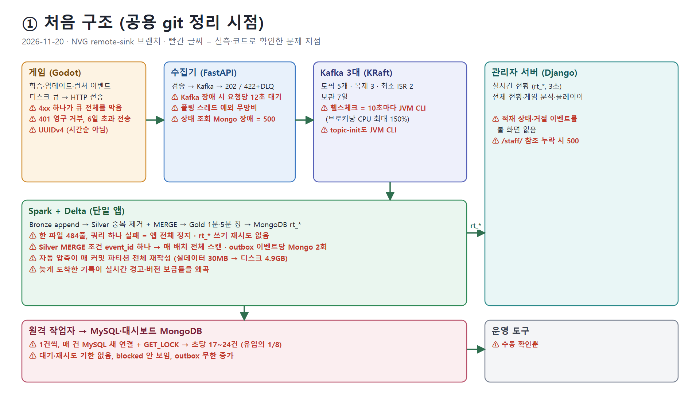
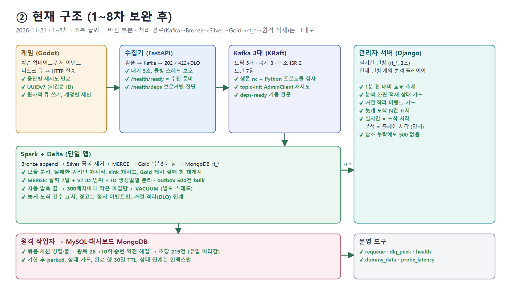
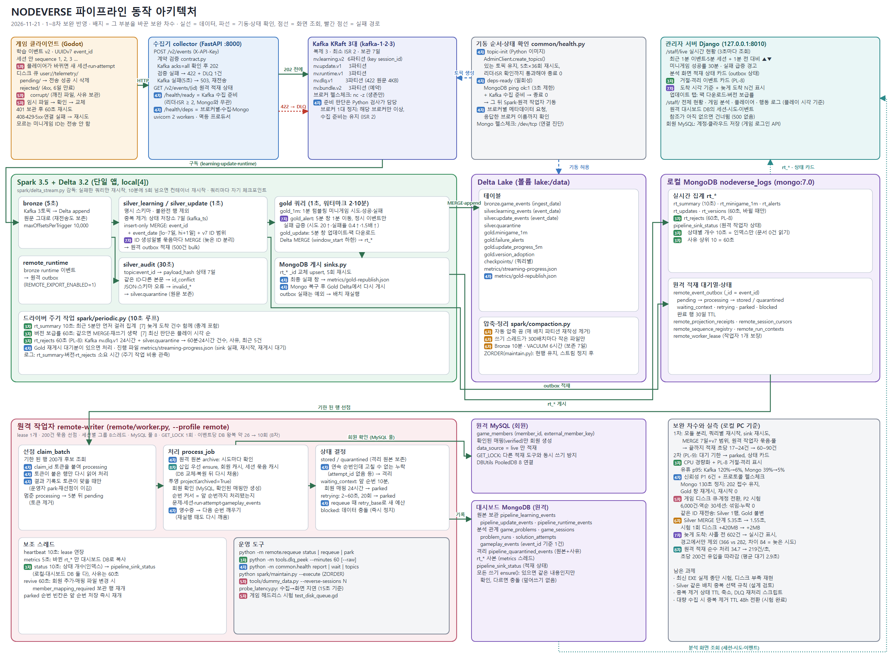
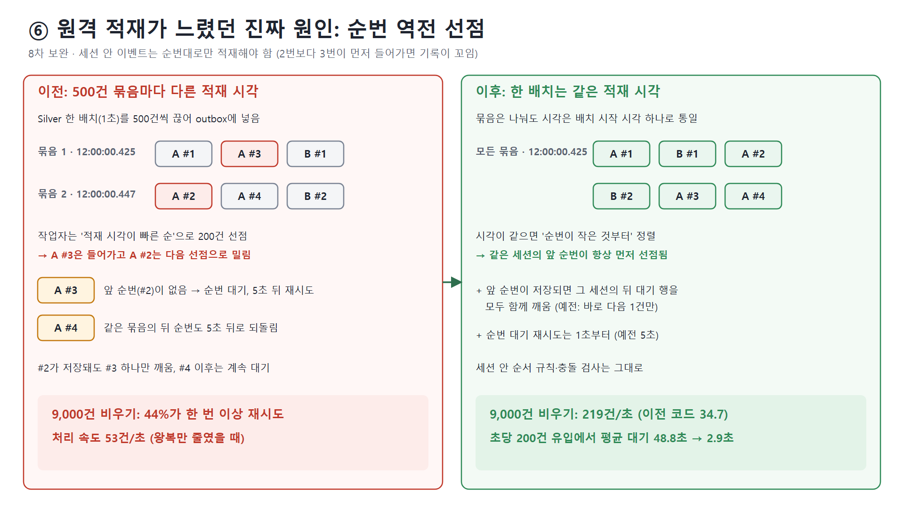
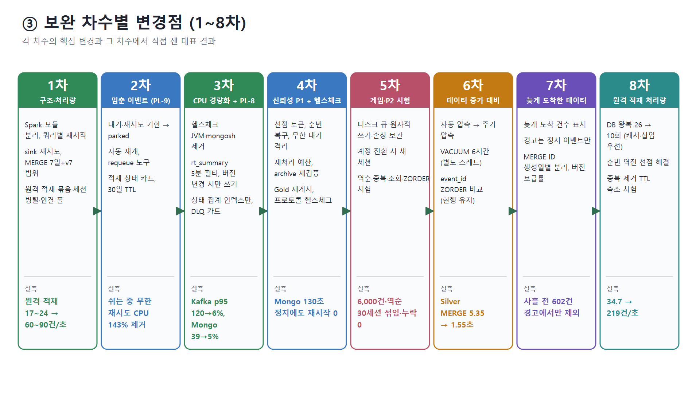
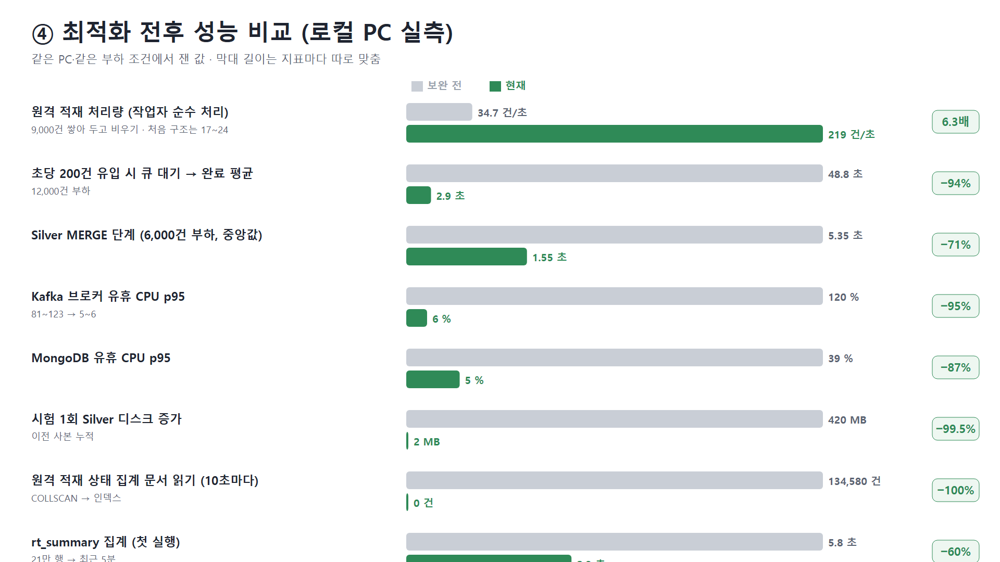
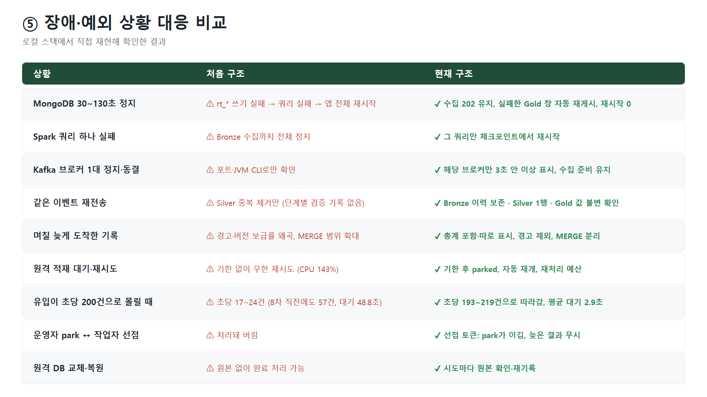

# NODEVERSE 파이프라인 구조 비교와 최적화 정리

- 대상: 공용 저장소 `encore-ai-campus/mlo-02-p3-team1`의 `pipeline/` (일부 `game/`, `server/` 포함)
- 비교 시점: **처음 구조** = 세 파트를 공용 git에 합친 직후(2026-11-20, NVG remote-sink 브랜치 32b0248). **현재 구조** = 1~8차 보완 후(2026-11-21)
- 모든 수치는 같은 로컬 PC(Windows 11 ARM64, WSL2 Docker, Spark 4코어)에서 직접 잰 값입니다. 운영 환경 수치는 아닙니다.
- 발표 자료용 그림은 `docs/presentation/fig-1~6.png`(1920×1080)에 따로 있습니다. 생성 스크립트는 `docs/presentation/pipeline_comparison.py`입니다.

## 요약

처리 경로(게임 → 수집기 → Kafka → Bronze → Silver → Gold → 실시간 화면, Silver → 원격 적재 → 분석 화면)와 토픽·이벤트 계약은 처음과 같습니다. 바꾼 것은 **각 단계의 처리 방식, 실패했을 때의 동작, 쉬는 중의 비용**입니다.

| 핵심 결과 | 처음 | 현재 |
|---|---|---|
| 원격 적재 처리량 (분석 화면까지) | 초당 17~24건 (유입의 1/8) | 초당 193~219건 (초당 200건 유입을 따라감) |
| 초당 200건 유입 시 큐 대기 → 완료 평균 | 48.8초 | 2.9초 |
| Silver MERGE 단계 (6,000건 부하) | 5.35초 | 1.55초 |
| 쉬는 중 Kafka 브로커 CPU p95 | 81~123% | 5~6% |
| 쉬는 중 MongoDB CPU p95 | 39% | 5% |
| 시험 1회 Silver 디스크 증가 | +420MB | +2MB |
| Spark 쿼리 하나 실패 | 앱 전체 정지 | 그 쿼리만 재시작 |
| MongoDB 130초 정지 | rt_* 쓰기 실패 → 앱 재시작 | 수집 계속, 실패한 창 자동 재게시, 재시작 0 |

## 1. 처음 구조

### 처음 구조에서 확인한 문제

| 구분 | 문제 | 근거 |
|---|---|---|
| 처리량 | 원격 적재가 1건씩, 매 건 MySQL 새 연결과 GET_LOCK | 초당 17~24건. 4.2만 건 부하 후 대기 35,230건, 소화 30분 이상 |
| 처리량 | Silver 배치 안 outbox 적재가 이벤트마다 Mongo 2회 | 배치 시간 대부분 |
| 처리량 | Silver MERGE 조건이 event_id 하나 | 매 배치 Silver 전체 스캔 |
| 처리량 | Delta 자동 압축이 매 커밋 날짜 파티션 전체를 다시 씀 | 실데이터 약 30MB인 Silver가 디스크 4.9GB, Bronze 7.5GB |
| 안정성 | Spark 쿼리 하나 실패 = 앱 전체 정지, rt_* 쓰기 재시도 없음 | Mongo가 잠깐 끊겨도 Bronze 수집까지 멈춤 |
| 안정성 | 수집기가 Kafka 장애 시 요청당 12초 대기, 폴링 스레드 예외 무방비 | 정상 요청까지 지연 |
| 안정성 | 원격 적재 대기·재시도에 기한 없음, blocked가 어디에도 안 보임 | 쉬는 중 CPU 143% 관측 |
| 비용 | 헬스체크가 10초마다 JVM CLI(Kafka)와 mongosh 실행 | 브로커당 CPU 최대 150%, Mongo 47% |
| 비용 | rt_summary가 10초마다 이틀 치(21만 행) 집계, 상태 집계가 outbox 전체 스캔 | 13.5만 문서 읽기 |
| 정합성 | 운영자 park와 작업자 선점 경쟁, 다음 순번 깨우기 실패 시 세션 정지, 원격 DB 교체 뒤 원본 누락 가능 | 메모리 시험으로 재현 |
| 정합성 | 늦게 도착한 기록이 실시간 경고·버전 보급률을 왜곡, MERGE 범위를 넓힘 | 코드·재현 시험 |
| 게임 | 4xx 하나가 큐 전체를 막음, 401 영구 거부, 6일 초과 전송, UUIDv4 | 게임 코드 |

## 2. 현재 구조

### 상세 동작 아키텍처

### 처음과 같은 것

- 토픽 5개(`nv.learning.v2` 6파티션, `nv.update.v1`·`nv.runtime.v1`·`nv.dlq.v1`·`nv.bundle.v2` 3파티션), 복제 3, 최소 ISR 2, 보관 7일
- 수집 계약(`contract.py`)과 응답(202 / 422+DLQ / 503)
- Bronze 원본 append → Silver 상태 저장소 중복 제거 + insert-only MERGE → Gold 1분 텀블링·5분 슬라이딩 창 → MongoDB rt_*
- 원격 적재 상태 이름(pending, processing, stored, quarantined, waiting_context, retrying, blocked)에 parked만 추가

## 3. 구성 요소별로 무엇을 어떻게 바꿨나

처리 경로는 그대로 두고, 각 단계의 내부 구조를 바꿨습니다. 단계마다 **이전 → 바꾼 방법 → 결과** 순서로 적었습니다.

### 3-1. 수집기 (FastAPI)

| 이전 | 바꾼 방법 | 결과 |
|---|---|---|
| Kafka가 느려지면 요청 스레드가 최대 12초씩 묶임. 전송 확인 스레드가 예외 한 번에 죽을 수 있음. 헬스체크는 메타데이터 조회만 | 대기 5초, 폴링 스레드 예외 보호. `/health/ready` = 모든 토픽 파티션에 리더가 있고 ISR ≥ 2일 때만 준비. `/health/deps` = 브로커별 응답·Mongo 따로 표시 | 브로커 1대 정지·Mongo 정지 중에도 수집은 202로 계속 |

### 3-2. Kafka 기동과 헬스체크

| 이전 | 바꾼 방법 | 결과 |
|---|---|---|
| 10초마다 JVM CLI(`kafka-topics.sh`)와 `mongosh`를 띄워 확인. 쉬는 중에도 브로커당 CPU 최대 150% | 컨테이너 헬스체크는 생존만, 실제 판단은 Python 공통 모듈(`common/health.py`). topic-init은 AdminClient로 재시도하며 생성. 기동 관문 deps-ready가 Mongo ping과 Kafka 수집 준비를 확인한 뒤 Spark·원격 작업자 기동 | 유휴 CPU p95 Kafka 81~123% → 5~6%, Mongo 39% → 5% |

### 3-3. Spark 앱 구조

| 이전 | 바꾼 방법 | 결과 |
|---|---|---|
| 한 파일 484줄, 쿼리 하나 실패 = 앱 전체 정지, MongoDB 쓰기 재시도 없음 | bronze·silver·gold·sinks·periodic·compaction 모듈 분리. 감독 루프가 실패한 쿼리만 체크포인트에서 재시작(10분 5회 초과 시 컨테이너 재시작). rt_* 쓰기 5회 재시도, 끝내 실패한 창은 기록해 두었다가 Gold Delta에서 재게시 | Mongo 130초 정지에도 재시작 0, 빠진 창 자동 복구 |

### 3-4. Silver MERGE와 파일 정리

| 이전 | 바꾼 방법 | 결과 |
|---|---|---|
| MERGE 조건이 `event_id` 하나 → 배치마다 Silver 전체 스캔. Delta 자동 압축이 커밋마다 날짜 파티션 전체 재작성(실데이터 30MB가 디스크 4.9GB) | 조건에 날짜 범위(배치 날짜 −7일~+1일)와 UUIDv7 ID 범위 추가(게임 ID를 시간순 v7로). ID 생성일별로 나눠 MERGE. 자동 압축을 끄고 쓰기 스레드가 300배치마다 작은 파일만 압축(outbox 적재·Mongo 게시가 끝난 뒤), VACUUM은 별도 스레드 6시간마다 | MERGE 단계 5.35 → 1.55초, 시험 1회 디스크 +420MB → +2MB |

### 3-5. 주기 집계

| 이전 | 바꾼 방법 | 결과 |
|---|---|---|
| rt_summary가 10초마다 이틀 치(21만 행) 집계, 버전 보급률은 같아도 매분 MERGE·재쓰기 | 최근 5분만 먼저 걸러 집계, 버전 보급률은 바뀔 때만 쓰기(최신 판단은 플레이 시각 기준), 거절·격리(DLQ) 집계와 늦게 도착 건수 추가 | 첫 집계 5.8 → 2.3초, 쉬는 중 쓰기 제거 |

### 3-6. 원격 작업자 (outbox → 분석 화면 DB)

| 이전 | 바꾼 방법 | 결과 |
|---|---|---|
| 1건씩, 매 건 MySQL 새 연결 + GET_LOCK → 초당 17~24건. 대기·재시도 기한 없음, blocked가 안 보임 | 200건 묶음 선점, 세션별 그룹 8스레드(세션 안은 순번 순서), MySQL 연결 풀, GET_LOCK 1회. 기한·횟수 초과 시 parked와 자동 재개, 상태 집계는 인덱스만. 선점 토큰(운영자 park가 이김), 순번 복구, 고칠 수 없는 이벤트 격리. 이벤트당 DB 왕복 약 26 → 10회(삽입 우선, 회원 캐시, 세션 캐시). 순번 역전 선점 해결(아래 그림) | 초당 17~24 → 219건, 초당 200건 유입에서 평균 대기 48.8 → 2.9초 |

### 3-7. 늦게 도착한 데이터

| 이전 | 바꾼 방법 | 결과 |
|---|---|---|
| 사흘 전 기록이 오늘 오면 실시간 경고와 버전 보급률을 왜곡, MERGE 범위를 넓힘 | "늦은 이벤트" 정의를 `common/lateness.py` 하나로. 실시간 화면은 총계에 포함하되 따로 표시, 실패 급증 경고는 정시 이벤트만, MERGE는 ID 생성일별 분리. 원칙: 실시간 화면 = 도착 시각, 분석 화면 = 플레이 시각 | 사흘 전 602건: 총계·표시 정상, 경고에서만 제외 |

### 3-8. 게임 송신

| 이전 | 바꾼 방법 | 결과 |
|---|---|---|
| 4xx 하나가 큐 전체를 막음, 401 영구 거부, UUIDv4 | 응답별 처리(4xx는 그 건만 거절, 401은 보관 후 재시도), UUIDv7, 6일 지난 기록 만료, 디스크 큐 원자적 쓰기·손상 파일 보관, 계정 전환 시 새 세션 | 헤드리스 시험 17개 통과, 역순·다수 사용자 시험에서 섞임·누락 0 |

### 3-9. 한 줄 요약

1. 한 곳의 실패가 전체를 멈추던 구조 → 실패를 그 자리에서 가두는 구조
2. 매번 전체를 읽고 쓰던 방식 → 필요한 범위만 다루는 방식
3. 끝없이 기다리던 처리 → 기한·표시·자동 복구가 있는 처리

## 4. 보완 차수별 변경점

| 차수 | 주제 | 주요 변경 | 대표 실측 |
|---|---|---|---|
| 1차 | 구조·처리량 | Spark를 bronze·silver·gold·sinks·periodic 모듈로 분리, 실패한 쿼리만 재시작, rt_* 쓰기 5회 재시도, MERGE 조건에 날짜 7일과 UUIDv7 ID 범위 추가, outbox 500건 bulk, 원격 적재 200건 묶음·세션별 8스레드·MySQL 연결 풀, 수집기 대기 5초, 게임 UUIDv7·응답별 재시도 | 원격 적재 17~24 → 60~90건/초, outbox 적재 0.37초 |
| 2차 | 멈춘 이벤트 (PL-9) | 대기·재시도 기한 후 parked, 조건이 맞으면 자동 재개, requeue 도구, 분석 화면 적재 상태 카드, 완료 행 30일 TTL | 쉬는 중 무한 재시도 제거 |
| 3차 | CPU 경량화 + PL-8 | 헬스체크에서 JVM CLI·mongosh 제거, rt_summary 최근 5분 필터, 버전 보급률은 바뀔 때만 쓰기, 상태 집계는 인덱스만, 거절·격리(DLQ) 집계와 화면 카드 | Kafka p95 81~123% → 5~6%, Mongo 39% → 5% |
| 4차 | 신뢰성 P1 + 헬스체크 | 선점 토큰, 다음 순번 복구, 고칠 수 없는 이벤트 격리, 수동 재처리 예산, archive 재검증, Gold 게시 실패 창 재게시, Python 프로토콜 헬스체크(브로커별·수집 준비·Mongo ping), deps-ready 기동 관문 | Mongo 130초 정지에도 수집 계속·재시작 0 |
| 5차 | 게임·P2 시험 | 게임 디스크 큐 원자적 쓰기·손상 파일 보관, 계정 전환 시 새 세션·run·attempt, 역순·중복·동시 조회·ZORDER 시험 | 6,000건·역순 30세션 섞임·누락 0 |
| 6차 | 데이터 증가 대비 | Delta 자동 압축 끔 → 쓰기 스레드가 300배치마다 작은 파일만 압축, Bronze 10분 압축, VACUUM 6시간(별도 스레드), event_id 단독 ZORDER 비교(현행 유지) | Silver MERGE 5.35 → 1.55초, 디스크 +420MB → +2MB |
| 7차 | 늦게 도착한 데이터 | 늦은 이벤트 정의 통일, 실시간 요약에 늦게 도착 건수, 실패 급증 경고는 정시 이벤트만, MERGE를 ID 생성일별로 분리, 버전 보급률은 플레이 시각 순, "실시간 = 도착 시각 / 분석 = 플레이 시각" 원칙 | 사흘 전 602건: 총계 포함·따로 표시, 경고에서만 제외 |
| 8차 | 원격 적재 처리량 | 삽입 우선 ensure, 회원 캐시·지연 MySQL 연결, 세션 묶음 캐시로 이벤트당 DB 왕복 약 26 → 10회. 세션의 뒤 순번이 먼저 선점되던 문제(44% 재시도) 해결: Silver 배치 적재 시각 통일, 대기 행 함께 깨우기, 순번 대기 1초부터. 중복 제거 TTL 축소 호환 시험 | 작업자 순수 처리 34.7 → 219건/초, 평균 대기 48.8 → 2.9초 |

## 5. 성능 전후 비교

| 지표 | 처음 | 현재 | 측정 조건 |
|---|---|---|---|
| 원격 적재 처리량 (끝까지) | 초당 17~24건 (1차 후 60~90건) | 초당 193.6건 (유입 200건/초를 따라감) | 12,000건, 초당 200건 유입 |
| 원격 작업자 순수 처리 | 34.7건/초 (8차 전) | 219.2건/초 | 작업자를 멈춘 채 9,000건 쌓은 뒤 비우기 |
| 큐 대기 → 완료 평균 | 48.8초 | 2.9초 | 12,000건, 초당 200건 유입 |
| Silver MERGE 단계 중앙값 | 5.35초 | 1.55초 | 6,002건, 초당 100건, 같은 스택 (자동 압축 끈 전후) |
| Silver learning 배치 중앙값 | 5.65초 | 1.75초 | 같은 조건 |
| Kafka 브로커 유휴 CPU p95 | 81~123% (1코어 넘은 표본 27개/5분) | 5~6% (0개) | 부하 없음 5분, docker stats 약 2초 간격 |
| MongoDB 유휴 CPU p95 | 39% | 5% | 같은 조건 |
| 시험 1회 디스크 증가 (Silver / Bronze) | +420MB / +633MB | +2MB / +2MB | 6,002건 부하 1회 |
| 원격 적재 상태 집계 | 문서 134,580건 읽기 (42 ms) | 문서 0건, 인덱스 키만 | outbox 13.5만 행, 10초마다 |
| rt_summary 첫 실행 | 5.8초 | 2.3초 | 이틀 치 21.9만 행 중 최근 5분 6천 행 |
| 대시보드 반영 지연 | 12.89초 (1회) | 최대 10~12초 (15초 기준 통과) | probe_latency 3회, 부하 중 |

## 6. 장애·예외 상황 대응

모두 로컬 스택에서 직접 재현했습니다. 세부 기록은 `docs/changes/2026-11-20_pipeline_reliability.md`, `2026-11-21_reliability_p2.md`, `2026-11-21_late_events.md`에 있습니다.

## 7. 남은 과제

| 내용 | 이유 |
|---|---|
| 원격 작업자 다중 프로세스 | 초당 200건을 넘는 유입이 계속되면 다음 한계. 작업자는 lease로 1개 프로세스이므로 세션 단위로 나눠 여러 프로세스로 확장 |
| 중복 제거 상태 TTL (7일) | 기존 체크포인트에서 48시간으로 줄여도 안전함을 시험으로 확인. 지금 규모에서는 이득이 없어 기본값 유지, 대량 수집 때 `DEDUP_TTL_HOURS=48` |
| 최신 EXE 실제 종단 시험, 실제 디스크 부족 재현 | 게임 변경은 헤드리스 시험으로만 확인 |
| 파이프라인 진행 현황판 | 요청 검토 완료, 보류 (상태 스냅샷 + 서버 탭 방식) |

## 부록. 발표 자료용 그림

| 파일 | 내용 |
|---|---|
| `docs/presentation/fig-1-first.png` | ① 처음 구조와 문제 지점 |
| `docs/presentation/fig-2-current.png` | ② 현재 구조와 바뀐 부분 |
| `docs/presentation/fig-3-rounds.png` | ③ 보완 차수별 변경점과 대표 실측 |
| `docs/presentation/fig-4-metrics.png` | ④ 성능 전후 비교 막대 |
| `docs/presentation/fig-5-scenarios.png` | ⑤ 장애·예외 상황 대응 비교 |
| `docs/presentation/fig-6-sequence.png` | ⑥ 원격 적재가 느렸던 원인: 순번 역전 선점 |
| `docs/architecture/pipeline-architecture-2026-11-21.png` | 현재 동작 아키텍처 (상세) |

모두 1920×1080(16:9)이라 슬라이드에 그대로 넣을 수 있습니다. 같은 이름의 `.svg`는 크기를 바꿔도 깨지지 않는 원본입니다.
