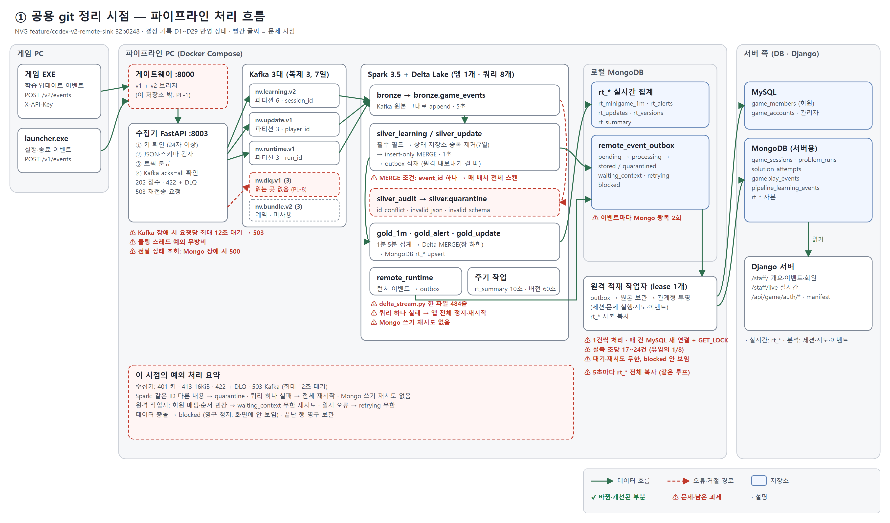
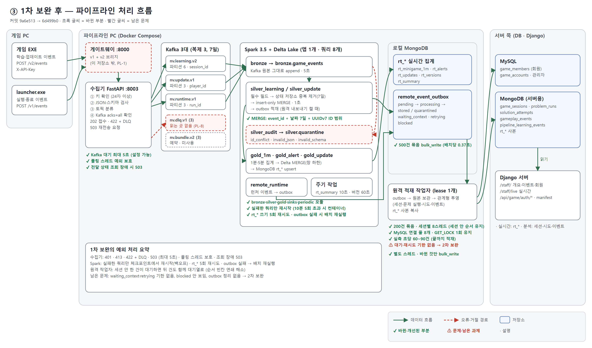
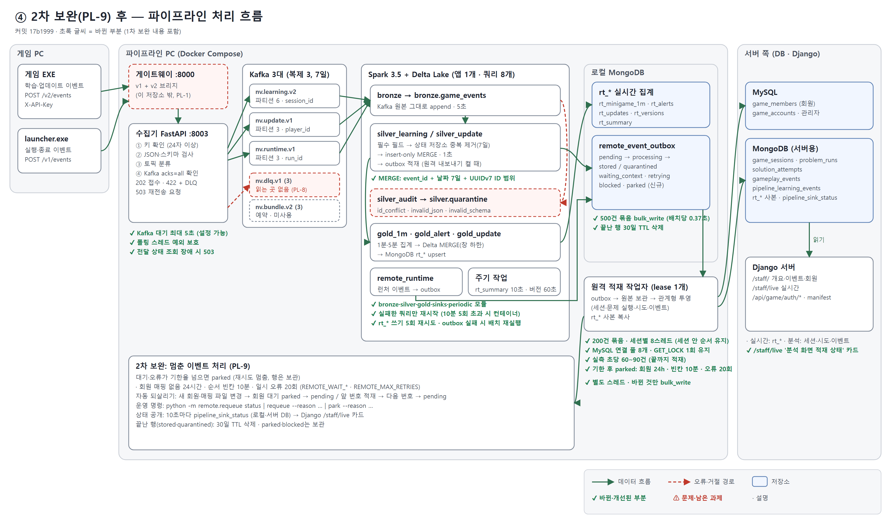
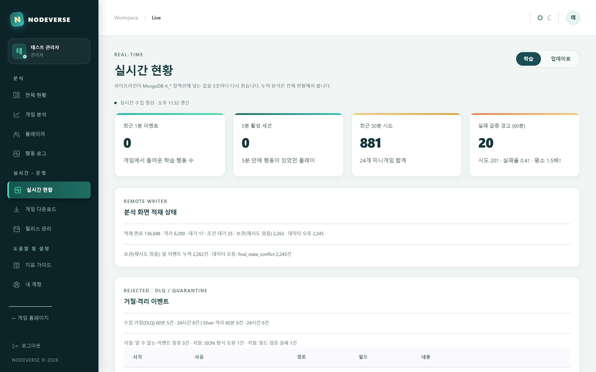
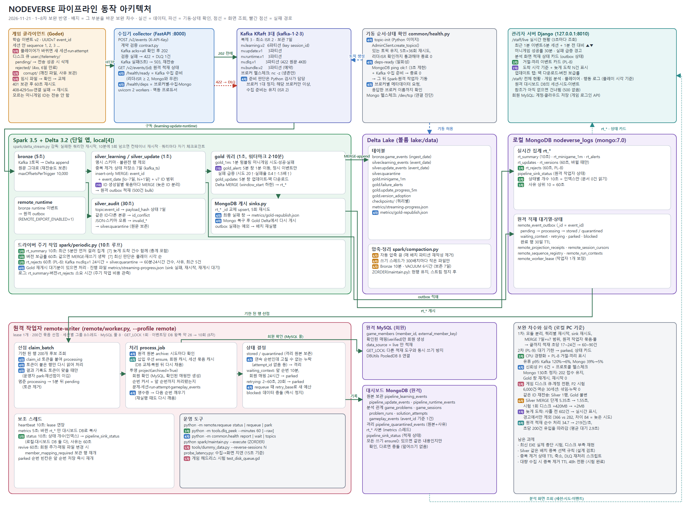

# NODEVERSE 변경 리포트 (2026-11-20)

- 대상 저장소: `encore-ai-campus/mlo-02-p3-team1`
- 시점 구분
  - **공용 git 정리 시점:** 세 파트를 통합 저장소에 합친 직후. 파이프라인은 NVG `feature/codex-v2-remote-sink` 32b0248, 담당자 결정 기록 D1~D29까지 반영된 상태.
  - **1차 보완:** D29 상태의 코드를 기준으로 한 첫 보완. 커밋 `9a6e513` → `6d499b0` (17:46~19:03 KST)
  - **2차 보완:** PL-9(멈춘 이벤트 처리). 커밋 `17b1999` (22:18 KST)
  - **3차 보완:** CPU 경량화(codex 검토 반영) + PL-8(거절·격리 이벤트 표시). 커밋 `5a44124`, `eb27159` (23:40 KST)
  - **4차 보완:** codex 신뢰성 검토 P1 6건 + 프로토콜 헬스체크. 커밋 `f583cec`
  - **5차 보완:** 같은 검토의 남은 항목(게임 디스크 큐·계정 전환, 부하·중복·조회 시험, ZORDER 비교). 커밋 `f3c197d`
  - **6차 보완:** 데이터 증가 시 Silver MERGE 성능 검토(독립 검토 후 재확인), 자동 압축 → 주기 압축·VACUUM, event_id ZORDER 비교
  - **7차 보완:** 늦게 도착한 데이터 처리(실시간 표시, 정시 기준 경고, MERGE 입력 분리, 버전 보급률, 시간축 원칙). 커밋 `ab01976`
  - **8차 보완:** 원격 적재 처리량(DB 왕복 축소, 순번 역전 선점 해결), 중복 제거 TTL 축소 호환 시험 (11-21 09:00 KST 전후)
- 수치는 이 PC(Windows 11 ARM64 20코어, WSL2 Docker, Spark 4코어)에서 직접 잰 값입니다. 운영 환경 값은 아닙니다.
- 문제 번호(PL-·BN-·GM-·SV-·CM-·RF-)는 `docs/DATA_FLOW_AND_GAPS.md`의 항목 번호입니다.

### 용어 설명

| 용어 | 뜻 |
|---|---|
| **수집기** (collector) | 게임이 보내는 이벤트를 받는 입구 API(`/v2/events`). 형식을 검사하고 Kafka에 넣은 뒤 202로 응답 |
| **토픽** | Kafka 안의 이벤트 칸. 학습·업데이트·실행·거절(DLQ) 이벤트를 종류별로 나눠 담음 |
| **DLQ** (Dead Letter Queue) | 형식이 틀려 거절된(422) 이벤트 원문을 따로 모아 두는 토픽 |
| **Bronze / Silver / Gold** | Spark가 만드는 Delta 테이블 3단계. Bronze = 받은 그대로 보관, Silver = 검증·중복 제거된 이벤트, Gold = 1분·5분 단위 집계 |
| **MERGE** | Silver에 넣을 때 같은 이벤트 ID가 이미 있는지 확인하며 넣는 명령. 중복 저장을 막지만, 확인할 범위가 넓으면 느려짐 |
| **격리** (quarantine) | 같은 ID에 내용이 다르거나 필수 값이 빠진 이벤트를 정상 데이터와 섞지 않고 따로 보관하는 곳 |
| **rt_\* 컬렉션** | Gold 집계를 대시보드 실시간 화면용으로 MongoDB에 복사해 둔 것 (`rt_minigame_1m`, `rt_summary` 등) |
| **원격 적재** | 파이프라인 PC의 이벤트를 **서버 쪽 DB**(대시보드가 읽는 MySQL·MongoDB)로 옮겨 넣는 일. 이벤트를 그대로 넣는 게 아니라 대시보드가 쓰는 형태(회원·세션·문제 실행·풀이 시도·행동 이벤트)로 바꿔서 넣음. 서버 DB가 파이프라인 PC 밖(다른 PC)에 있어서 "원격"이라고 부름 |
| **원격 작업자** (remote writer, `remote/worker.py`) | 원격 적재를 실제로 하는 프로그램(컨테이너 `remote-writer`). 대기열(outbox)에서 이벤트를 꺼내 서버 DB에 씀 |
| **outbox** (`remote_event_outbox`) | 원격 적재를 기다리는 이벤트 대기열. Silver를 통과한 이벤트가 여기 쌓이고, 원격 작업자가 하나씩 처리하며 상태를 바꿈 |
| **outbox 상태** | `pending` 대기 → `processing` 처리 중 → `stored` 적재 완료 / `quarantined` 격리 적재. 문제가 있으면 `waiting_context`(회원 매핑·앞 번호 기다림), `retrying`(일시 오류 재시도), `blocked`(데이터 충돌로 정지), `parked`(기한이 지나 재시도를 멈추고 보관, 2차 보완에서 추가) |
| **회원 매핑** | 게임 이벤트의 `player_id`가 서버의 어느 회원(`game_members`)인지 연결하는 것. 없으면 분석 화면에 넣을 수 없어 대기 |
| **순서 빈칸** (sequence gap) | 한 플레이 세션의 이벤트 번호가 1, 2, 4처럼 비는 것. 앞 번호가 올 때까지 뒤 번호는 적재하지 않음 |
| **lease** | 원격 작업자가 동시에 두 개 돌지 않도록 한 프로그램만 "작업 권한"을 갖게 하는 잠금 |
| **연결 풀** (DBCP 방식) | DB 연결을 매번 새로 만들지 않고 미리 만든 연결을 돌려 쓰는 방식 |
| **UUIDv7** | 앞부분에 시각이 들어간 이벤트 ID 형식. 시간순으로 커져서 Delta가 파일을 건너뛰며 찾을 수 있음 |
| **게이트웨이** | 게임이 실제로 접속하는 `.81:8000` 입구. 받은 이벤트를 v2 수집기로 넘김 (설정이 저장소 밖에 있음, PL-1) |

---

## 1. 공용 git 정리 시점의 파이프라인 상태

### 1-1. 토픽 (`pipeline/topics.py`, Kafka 3대 · 복제 3 · 최소 ISR 2 · 보관 7일)

| 토픽 | 파티션 | 키 | 내용 |
|---|---|---|---|
| `nv.learning.v2` | 6 | session_id | 학습 이벤트 8종 (problem_started … problem_completed) |
| `nv.update.v1` | 3 | player_id | 업데이트 이벤트 9종 (update_checked … build_changed) |
| `nv.runtime.v1` | 3 | run_id | 런처 실행·종료 이벤트 (run_*, exit_*) |
| `nv.dlq.v1` | 3 | event_id | 수집기가 422로 거절한 원문(4KB까지)과 사유 |
| `nv.bundle.v2` | 3 | — | 예약(생산자·소비자 없음, D2) |

### 1-2. 처리 흐름

(원본 SVG: `docs/reports/images/flow-1-consolidation.svg`)

### 1-3. 예외 처리

| 위치 | 상황 | 처리 |
|---|---|---|
| 수집기 | 키 틀림 | 401 |
| 수집기 | 본문 16KiB 초과 | 413 (본문을 먼저 다 읽은 뒤 확인) |
| 수집기 | 깨진 JSON·스키마 오류·모르는 event_type·6일 초과 | 422 + DLQ 토픽 기록 (DLQ 기록 실패 시 `dlq:false`) |
| 수집기 | Kafka 전송 실패·지연 | 요청 스레드가 **최대 12초** 대기 후 503 (같은 event_id로 재전송 요청) |
| 수집기 | Kafka 폴링 스레드 예외 | 처리 없음 (스레드가 죽으면 모든 요청이 12초 후 503) |
| 수집기 | 전달 상태 조회 중 Mongo 장애 | 처리 없음 → 500 |
| Spark | 쿼리 하나 실패 | `awaitAnyTermination` → **앱 전체 종료** → Docker 재시작 (Bronze 수집까지 멈춤, 데이터는 Kafka 7일 보관으로 보존) |
| Spark | Mongo rt_* 쓰기 실패 | 재시도 없음 → 해당 쿼리 실패 → 위와 같음 |
| Spark | 같은 ID 다른 내용 | silver.quarantine `id_conflict` |
| 원격 작업자 | 회원 매핑 없음·순서 빈칸 | `waiting_context`, **기한 없이** 5~60초 간격 무한 재시도 |
| 원격 작업자 | 일시 오류 | `retrying`, **횟수 제한 없이** 재시도 |
| 원격 작업자 | 데이터 충돌 | `blocked` (영구 정지, 어디에도 표시 안 됨) |
| 원격 작업자 | 끝난 행 | 지우지 않음 (outbox 계속 증가) |

---

## 2. 보완 전 코드에서 발생할 수 있었던 문제

### 2-1. 성능·병목 (부하 시험 실측: 학습 이벤트 4.2만 건, 초당 약 175건)

| 번호 | 문제 | 근거·실측 |
|---|---|---|
| BN-5 | **원격 적재가 유입을 따라가지 못함** | 초당 17~24건 처리 (유입의 약 1/8). 부하 종료 시 대기 35,230건, 소화에 30분 이상 → 분석 화면이 수십 분 늦음 |
| BN-7 | 지표 복사가 시간이 갈수록 느려짐 | 5초마다 rt_* 전체 복사, 적재 루프와 같은 스레드 |
| BN-8 | Silver 배치 안 outbox 적재 | 이벤트마다 Mongo 왕복 2회, 드라이버에서 한 건씩 |
| BN-1 | Silver MERGE가 매번 Silver 전체를 읽음 | 조건이 `event_id` 하나뿐, 날짜 파티션·ID 통계 활용 불가 (D23 메모에도 D19 성능 설명 미적용 명시) |
| BN-2·3 | Gold 로그·작은 파일 누적 | 1초 트리거 커밋, OPTIMIZE 수동 |
| BN-9 | 수집기 스레드 점유 | Kafka 장애 시 요청당 12초 |
| BN-4 | 지연 근거 부족 | 클라우드 10~53초(CPU 포화), 로컬 12.89초 1회 → 로컬 재측정 결과 평시 5~9초, 부하 중 8.6~12.1초 (15초 목표 통과) |

### 2-2. 안정성·예외 처리

| 번호 | 문제 | 영향 |
|---|---|---|
| PL-2 | 쿼리 하나 실패 = 전체 정지 | 로컬 Mongo가 잠깐 끊겨도 Bronze 수집까지 멈춤, 재시작 반복 |
| PL-3·4 | 수집기 12초 대기, 폴링 스레드 무방비 | Kafka 장애 시 정상 요청·상태 확인까지 지연 |
| PL-6 | 전달 상태 조회 500 | Mongo 장애 시 원인 불명 오류 |
| PL-9 | 멈춘 이벤트가 영원히 재시도·보이지 않음 | CPU 낭비(쉬는 중 143% 관측), 운영자가 알 수 없음 |
| PL-10 | outbox 무한 증가 | 디스크·조회 비용 증가 |
| BN-6 | 세션 순서 빈칸이 생기면 그 세션 전체 정지 | 뒤 이벤트가 각자 백오프로 대기 |
| PL-8 | DLQ·격리를 읽는 곳 없음 | 거절 이벤트 확인 불가 |
| PL-1 | 운영 게이트웨이 설정이 저장소에 없음 | 저장소만으로 운영 경로 재현 불가 |
| (검토서 5절) | Silver MERGE에 짧은 날짜 범위를 붙이면 늦은 재전송을 놓칠 위험 | 1차 보완 중 ±1일로 넣었다가 7일로 바로잡음 |

### 2-3. 게임 송신 쪽에서 파이프라인에 영향을 준 문제

| 번호 | 문제 |
|---|---|
| GM-1 | 큐 맨 앞 이벤트가 4xx(413 등)를 받으면 뒤 이벤트 전부 정지 |
| GM-2 | 401(키 오류) 이벤트를 영구 거부 → 키를 고쳐도 재전송 안 됨 |
| GM-3 | player-login이 수집기 주소로 수집 키를 보내 항상 실패 |
| GM-4 | 6일 지난 이벤트를 보내 `too_old`로 거절됨 |
| GM-5 | 모르는 미니게임 ID를 ST01로 바꿔 배열 통계 오염 |
| GM-9 | 테스트 봇이 첫 컴퓨터에서 영원히 멈춤 |

---

## 3. 1차 보완 후 파이프라인 상태

### 3-1. 토픽

변경 없음 (1-1과 같음). 이벤트 형식(`contract.py`)도 변경 없음. 게임 이벤트 ID가 UUIDv7(시간순)로 바뀌었지만 같은 UUID 문자열 형식입니다.

### 3-2. 처리 흐름

(원본 SVG: `docs/reports/images/flow-3-after-fix1.svg`)

### 3-3. 예외 처리

| 위치 | 상황 | 1차 보완 후 |
|---|---|---|
| 수집기 | Kafka 지연 | 최대 5초 대기 후 503 |
| 수집기 | 폴링 스레드 예외 | 로그 남기고 계속 폴링 |
| 수집기 | 전달 상태 조회 중 Mongo 장애 | 503 + 사유 |
| Spark | 쿼리 하나 실패 | **그 쿼리만** 체크포인트에서 재시작(백오프 2~30초). 10분 안 5회 초과 시 컨테이너 재시작 |
| Spark | rt_* 쓰기 실패 | 5회 재시도 후 로그 남기고 배치 통과 (Gold Delta는 정확, 다음 갱신 때 복구) |
| Spark | outbox 쓰기 실패 | 재시도 후에도 실패하면 배치 재실행 (이벤트를 건너뛰지 않음) |
| Spark | 실패·재시작 기록 | `/data/metrics/streaming-progress.json`의 `sink_failures`, `query_restarts` |
| 원격 작업자 | 세션 안 한 이벤트 대기 | 같은 세션의 뒤 이벤트를 같은 시각으로 대기열에 되돌림 (각자 백오프로 실패하지 않음) |
| 원격 작업자 | 대기·재시도 기한 | **여전히 없음** (→ 2차 보완) |

### 3-4. 1차 보완 결과 (실측)

| 항목 | 보완 전 | 1차 보완 후 |
|---|---|---|
| 원격 적재 (회원 매핑 대기로 끝나는 처리) | 초당 17~24건 | 초당 248건 |
| 원격 적재 (끝까지 적재) | 뒤처짐 | 초당 약 60~90건, 3만 건 중 29,900건 이상 `stored`, `blocked` 0 |
| Silver 배치 중 outbox 적재 | 배치 대부분 | 0.37초 |
| 대시보드 반영 지연 | 12.89초 1회 | 최대 10.1~11.1초 (부하 중) |
| 수집 | — | 3만 건 전부 202, p50 23ms |
| Silver MERGE | 평균 3.75초 (Silver 약 8만 행) | 평균 5.25초 (같은 날 파티션 약 14만 행). 날짜에 무작위 v4 ID가 섞여 ID 범위로 건너뛸 파일이 없음 → v7만 쌓인 새 레이크에서 재측정 필요 |
| 단위 테스트 | 41개 | 55개 |

---

## 4. 2차 보완 (PL-9)

### 4-1. 1차 보완 후에도 남아 있던 문제

| 문제 | 실제 관측 |
|---|---|
| `waiting_context`가 기한 없이 재시도 | 앞 번호가 `blocked`된 세션의 뒤 이벤트 2,245건이 영원히 `sequence_gap` 대기. 쉬는 중에도 작업자가 재시도 |
| `retrying` 횟수 제한 없음 | DB 장애가 길어지면 무한 재시도 |
| `blocked`·대기 건수를 볼 수 없음 | 서버 화면에 표시 없음 |
| outbox 무한 증가 | 시험 후 10만 건 이상 누적 |

### 4-2. 2차 보완 후 상태

**토픽:** 변경 없음.

**처리 흐름** (아래쪽 상자가 2차 보완으로 추가된 부분)

(원본 SVG: `docs/reports/images/flow-4-after-pl9.svg`)

**예외 처리 (원격 작업자 상태)**

| 상태 | 의미 | 다음 |
|---|---|---|
| `pending` → `processing` | 처리 대기·처리 중 | |
| `stored` / `quarantined` | 적재 완료 / 격리 적재 | 30일 뒤 삭제 |
| `waiting_context` | 회원 매핑·앞 번호 대기 (기한 안) | 5~60초 간격 재시도 |
| `retrying` | 일시 오류 (20회 안) | 2~60초 간격 재시도 |
| `parked` (신규) | 기한·횟수 초과, 재시도 멈춤 | 조건이 되면 자동, 또는 명령으로 `pending` |
| `blocked` | 데이터 충돌 | 즉시 정지 (기존과 같음), 화면에 건수·사유 표시 |

**확인 결과 (로컬)**

- 쌓여 있던 대기 2,252건이 10분 기한 뒤 자동으로 `parked` → 재시도 중단
- 서버 화면 카드: "적재 완료 97,322 · 보관(재시도 멈춤) 2,252 · 데이터 오류 2,245" (`docs/screenshots/server-4-live-sink.png`)
- 테스트: 파이프라인 58개(+4), 서버 56개 통과

### 4-3. 2차 보완 후에도 남은 과제

| 번호 | 내용 |
|---|---|
| BN-5 | 끝까지 적재(초당 60~90건)가 유입(150~185건)보다 느림 → 투영 코드의 이벤트당 Mongo 왕복(약 10회) 축소 |
| BN-1 | Silver MERGE: v7만 쌓인 새 레이크에서 효과 측정, 부족하면 D19(append) 복귀 또는 ZORDER 정기 실행 |
| PL-1 | 운영 게이트웨이 설정을 저장소로 |
| PL-8 | DLQ·격리 건수를 서버 화면에 → 3차 보완에서 완료 |
| RF-9·10 | Spark 처리 로직 단위 테스트, 시험 스크립트 정리 |

---

## 5. 3차 보완 (CPU 경량화 + PL-8)

### 5-1. 3차 보완 전에 남아 있던 문제

| 문제 | 실제 관측 (유휴 5분, `docker stats` 약 2초 간격, 100% = 1코어) |
|---|---|
| Kafka 헬스체크가 10초마다 JVM 관리 도구(`kafka-topics.sh --list`) 실행 | 브로커당 p95 81~123%, 최대 153%. 1코어 넘은 표본 3대 합계 27개 |
| MongoDB 헬스체크가 10초마다 `mongosh`(Node.js) 실행 | p95 39%, 최대 47% |
| `rt_summary`(10초)가 이틀 치 파티션 전체(약 21만 행)를 집계 | Spark 유휴 p95 147%, 1코어 넘은 표본 11개 |
| 버전 보급률(60초)이 값이 같아도 매번 Delta MERGE + Mongo 재쓰기 | 쉬는 중에도 MERGE 1회/분 |
| 원격 적재 상태(10초)가 outbox 전체를 `$group` | 13.5만 문서 전체 읽기(COLLSCAN) 42 ms |
| 원격 적재가 이벤트마다 archive를 두 번 기록 시도 | 두 번째는 조회·비교만 하지만 이벤트당 Mongo 왕복 1회 추가 |
| PL-8: 수집 거절(DLQ)·Silver 격리를 읽는 곳이 없음 | 422 이벤트는 `nv.dlq.v1`에 쌓이기만 하고 확인 수단 없음 |

### 5-2. 바꾼 것

| 항목 | 이후 | 파일 |
|---|---|---|
| Kafka 헬스체크 | `nc -z localhost 9092` (포트 수신만 확인) | `pipeline/build_compose.py` |
| topic-init | 토픽 생성 전체를 5초 간격 최대 36회 재시도. 실제 Kafka API(쿼럼, RF3용 브로커 3대)가 응답해야 통과 | `pipeline/build_compose.py` |
| MongoDB 헬스체크 | `/dev/tcp/127.0.0.1/27017` 연결 (mongod는 저장소 복구 뒤에 포트를 엶) | `pipeline/build_compose.py` |
| rt_summary | 파티션 필터 + 최근 5분(`received_at`)으로 먼저 거른 뒤 두 열만 집계 | `pipeline/spark/periodic.py` |
| 버전 보급률 | 매분 다시 계산(24시간 만료 반영)하되 (종류·버전·설치 수)가 같으면 MERGE·재쓰기 생략. Mongo 쓰기 실패 시 다음 분에 다시 | `pipeline/spark/periodic.py`, `sinks.py` |
| 원격 적재 상태 | 상태별 개수는 인덱스(`distinct` + `count`), 사유 집계는 60초마다 | `pipeline/remote/requeue.py`, `worker.py` |
| archive | 행마다 한 번. 재시도 행은 건너뜀 | `pipeline/remote/worker.py`, `projection.py` |
| PL-8 집계 | Spark가 1분마다 `nv.dlq.v1`(최근 24시간)과 `silver.quarantine`을 읽어 MongoDB `rt_rejects`에 60분·24시간 건수, 사유 상위 10개, 최근 거절 5건(원문 제외) 기록 | `pipeline/spark/periodic.py` |
| PL-8 화면 | 실시간 현황에 "거절·격리 이벤트" 카드 | `server/telemetry/live.py`, `live.html`, `live.js` |
| PL-8 원문 확인 | `python -m tools.dlq_peek --minutes 60 [--reason …] [--raw]` (collector 컨테이너 안, 오프셋을 커밋하지 않음) | `pipeline/tools/dlq_peek.py` |

### 5-3. 측정 결과

**유휴 5분 (p95 / 최대 / 1코어 넘은 표본)**

| 컨테이너 | 이전 | 이후 |
|---|---|---|
| kafka-1 / 2 / 3 | 118 / 81 / 123% · 최대 154% · 27개 | 6 / 5 / 6% · 최대 17% · 0개 |
| mongo | 39% · 47% · 0개 | 5% · 7% · 0개 |
| spark | 147% · 310% · 11개 | 57% · 321% · 5개 |

**부하 시험 (같은 조건: 6,002건, 초당 100건, 592세션)**

| 항목 | 이전 | 이후 |
|---|---|---|
| Silver learning 배치 중앙값 (MERGE) | 5.55초 (5.30초) | 5.50초 (5.10초) |
| 대시보드 지연 최대 (15초 기준) | 11.1초 통과 | 12.4초 통과 |
| 원격 적재 완료 / 최종 잔량 | 114초 / 0 | 120초 / 0 |
| 부하 중 Kafka 1코어 넘은 표본 | 20개 | 1개 |
| sink 실패 · 쿼리 재시작 | 0 · 0 | 0 · 0 |

부하 처리량은 그대로입니다. 이번 보완은 쉬는 중·주기 작업 비용을 줄이는 것입니다.

**정확성·장애 확인**

| 확인 | 결과 |
|---|---|
| rt_summary 이전·이후 식 (같은 시각 3회씩) | 값 동일 (4,758 / 592, 4,635 / 592). 첫 실행 5.8초 → 2.3초 |
| 원격 적재 상태 개수 | 기존 `$group`과 동일. 읽은 문서 134,580 → 0 |
| 브로커 3대를 늦게 기동 (25초) | topic-init 5회 재시도 후 41초에 정상 종료 |
| 브로커 1대만 있을 때 RF3 토픽 생성 | 포트는 열려 있어도 생성 실패 → 재시도 계속 (포트만으로 통과하지 않음) |
| MongoDB 30초 정지 | 38초 만에 healthy, 25초 안에 rt_summary·적재 상태 갱신 재개, 재시작 0 |
| 같은 이벤트 207건 두 번 전송 | Bronze 414행, Silver 207행, outbox 207행 |
| PL-8 | 잘못된 요청 5건 → 1분 안에 화면에 "수집 거절(DLQ) 60분 5건", 사유별 건수, 최근 5건 표시 |
| 테스트 | 파이프라인 60개(+2), 서버 57개(+1) 통과 |

### 5-4. 3차 보완 후에도 남은 과제

| 번호 | 내용 |
|---|---|
| - | 포트 헬스체크는 "프로세스는 멈췄는데 포트는 열린" 상태를 못 잡음. 실행 중 장애는 sink 실패 수·화면의 수집 지연 표시로 확인 |
| PL-8 후속 | DLQ 재처리 스크립트(원인 수정 후 다시 넣기)는 아직 없음. 지금은 확인(`dlq_peek`)까지 |
| BN-5 | 원격 적재(초당 약 50건)가 유입보다 느림 |
| BN-1 | Silver MERGE 배치당 약 5초. v7만 쌓인 새 레이크에서 비교 필요 |
| - | 상세 수치: `docs/changes/2026-11-20_pipeline_cpu.md` |

## 6. 4차 보완 (신뢰성 P1 + 프로토콜 헬스체크)

codex 검토 두 건(`pipeline/docs/RELIABILITY_REVIEW_REQUEST_2026-11-20.md`, `PROTOCOL_HEALTHCHECK_REQUEST_2026-11-20.md`)을 반영했습니다. 3차 보완의 포트만 확인하는 헬스체크는 "포트는 열렸는데 응답이 없는" 상태를 못 잡아서, 이미 Python 이미지에 있는 클라이언트(confluent-kafka, PyMongo)로 실제 응답을 확인하도록 바꿨습니다.

### 6-1. 4차 보완 전에 남아 있던 문제

| # | 문제 | 영향 |
|---|---|---|
| P1-1 | 원격 작업자가 행을 고른 뒤 운영자가 `park`해도 처리해 버림. 이전 작업자가 늦게 결과를 덮어쓸 수 있음 | 운영자 조치가 무시됨 |
| P1-2 | 다음 순번 깨우기가 실패하면 앞 이벤트를 다시 처리해도 뒤 이벤트가 계속 `parked` | 세션이 멈춤 |
| P1-3 | `attempt_id` 없는 이벤트, 열린 시도가 남은 `problem_completed`가 무기한 대기 | 세션 커서가 영원히 멈춤 |
| P1-4 | 재시도 한도로 보관된 행을 다시 넣으면 일시 오류 한 번에 다시 보관 | 수동 재처리가 사실상 안 됨 |
| P1-5 | 3차 보완에서 재시도 행의 archive 확인을 생략 → 원격 DB 교체·복원 뒤 원본 없이 `stored` | 원본 누락 |
| P1-6 | Gold 저장 뒤 MongoDB 게시가 실패해도 기록하지 않음 | 새 입력이 없는 창은 화면에서 영영 빠짐 |
| 헬스체크 | Kafka·Mongo가 포트만 확인. Spark·원격 작업자가 Mongo 포트만 보고 기동 | 멈춘 프로세스를 정상으로 판단 |

### 6-2. 바꾼 것

| 항목 | 이후 | 파일 |
|---|---|---|
| P1-1 선점 | 선점할 때 행마다 `claim_id`를 기록하고 그 토큰이 붙은 행만 처리. 결과 기록도 토큰이 맞을 때만 | `remote/worker.py` |
| P1-2 다음 순번 | 깨우기를 정상 처리와 재실행 양쪽에서 호출 | `remote/projection.py` |
| P1-3 무한 대기 | 연속 순번인데 고칠 수 없는 누락은 원문·사유를 남기고 격리. 실제 순번 누락은 계속 대기. 나머지 대기 사유도 24시간 뒤 보관 | `remote/projection.py`, `worker.py` |
| P1-4 재처리 예산 | `requeue` 때 `retry_base` 기록, 한도는 그 뒤 시도 수로. 누적 시도 수는 유지 | `remote/requeue.py`, `worker.py` |
| P1-5 archive | 시도마다 확인(있으면 조회 1회). 투영 안의 중복 기록만 계속 생략 | `remote/worker.py` |
| P1-6 Gold 재게시 | 게시 실패한 창 범위를 lake 볼륨 파일에 남기고, MongoDB가 응답하면 Gold Delta에서 다시 읽어 `_id`로 덮어씀 | `spark/gold.py`, `periodic.py` |
| 헬스체크 모듈 | `common/health.py`: 브로커별 응답(응답한 브로커 이름까지 확인), 수집 준비(토픽 5개 리더·ISR ≥ 2), MongoDB `ping` | `common/health.py` |
| topic-init | JVM CLI 대신 Python `AdminClient.create_topics()`, 재시도·기존 토픽 유지·생성 후 확인 | `build_compose.py` |
| 기동 순서 | 새 일회성 서비스 `deps-ready`(Mongo ping + Kafka 수집 준비) 통과 뒤 Spark·원격 작업자 기동 | `build_compose.py` |
| 수집기 | `/health/ready` = Kafka 수집 준비(Mongo와 무관), `/health/deps` = 브로커별·수집·Mongo 따로 표시 | `collector.py` |

브로커·Mongo 컨테이너의 Docker 헬스체크는 포트 확인으로 남겼습니다(두 이미지에 Python이 없음). 준비 여부는 위의 Python 검사가 판단합니다.

### 6-3. 확인 결과

| 시험 | 결과 |
|---|---|
| 브로커 1대 정지 | 그 브로커만 이상(3초 안), 수집 준비는 유지(ISR 2), 이벤트 60건 모두 202. 복구 6초 |
| 브로커 동결(포트 열림) | 그 브로커만 3초 안에 실패 표시 |
| MongoDB 동결(포트 열림) | `deps-ready` 13초에 실패 종료, 의존 서비스 기동 안 함. 수집은 계속 202 |
| MongoDB 130초 정지 중 400건 | 모두 202. Gold 게시 실패 2건 기록 → 복구 후 19행·115행 재게시, 대기 0. 재시작 0 |
| 새 볼륨 첫 기동 (별도 시험 스택) | 17초에 토픽 5개 생성, 파티션·RF 3·min ISR 2·보관 7일 그대로 |
| 같은 볼륨 재기동 | 8초, 새로 만든 토픽 없음 |
| 종단 추적 (이벤트 1건) | 202 → Bronze 1 → Silver 1 → outbox `stored` 132 ms → 원격 원본·`gameplay_events` 각 1 |
| 유휴 5분 CPU (p95) | Kafka 5~8%, Mongo 6%, 수집기 6% (3차 수준 유지) |
| 테스트 | 파이프라인 75개(+15), 서버 57개 통과 |

### 6-4. 4차 보완 후에도 남은 과제

| 내용 |
|---|
| 게임 쪽 P2: 디스크 큐 쓰기 실패·강제 종료, 로그아웃 뒤 계정 전환, 최신 EXE 종단 시험 |
| 다수 사용자·역순 입력 부하 시험, 같은 ID·다른 본문의 선택 규칙 |
| Silver `MERGE` 범위·워터마크·체크포인트 변경, `OPTIMIZE ZORDER` 전후 비교 (별도 설계 검토) |
| 처리 도중 `park`된 행은 투영을 중간에 멈추지 않음(멱등 기록은 끝나고 최종 상태만 기록 안 함) |
| 상세: `docs/changes/2026-11-20_pipeline_reliability.md` |

## 7. 5차 보완 (codex 신뢰성 검토의 남은 항목)

### 7-1. 바꾼 것

| 항목 | 이전 | 이후 | 파일 |
|---|---|---|---|
| 게임 디스크 큐 쓰기 | 바로 덮어씀. 쓰다 꺼지면 깨진 JSON | 임시 파일에 쓰고 확인한 뒤 교체. 실패는 횟수·사유로 남기고 메모리 큐로 전송 계속 | `game/scripts/network_manager.gd` |
| 깨진 큐 파일 | 조용히 건너뜀 | 완전한 임시 파일은 복구, 읽을 수 없는 파일은 `corrupt/`에 사유를 붙여 보관 | 같은 파일 |
| 로그아웃·계정 전환 | 이전 회원의 run·attempt를 다음 회원이 이어 씀 | 플레이어가 바뀌면 세션·run·attempt·순번을 모두 새로. 이미 만든 이벤트는 원래 회원 그대로 | 같은 파일 |
| 시험 도구 | - | Godot 헤드리스 시험 `test_disk_queue.gd`, 더미 데이터 `--reverse-sessions` | `game/scripts/tools/`, `pipeline/tools/dummy_data.py` |

### 7-2. 확인 결과

| 시험 | 결과 |
|---|---|
| 게임 디스크 큐·계정 전환 (Godot 헤드리스) | 17개 항목 통과 |
| 6,000건 · 초당 150건 · 30세션 역순 | 전부 stored. 회원 섞임 0, 순번 불연속 0, 누락 0. 역순 세션 p50 14.9초, 정상 세션 p50 11.1초 (막지 않음) |
| 같은 배치 같은 ID (같은 본문 20, 다른 본문 20) | Silver 20행씩, 모두 먼저 들어온 본문. 다른 본문 20건은 감사에서 id_conflict, Silver와 일치 |
| 적재 중 대시보드 조회 | 5개 화면·API 모두 200, 500 없음. 적재 후 summary 수렴 |
| 같은 이벤트 재전송 → Gold | 재전송 전후 1분 집계 동일 |
| OPTIMIZE ZORDER (복사본, 작은 파일 300개) | 행 수 같음, 파일 300 → 1. event_id 200개 조회 299개 파일 0.99초 → 1개 0.63초 |

### 7-3. 동작 아키텍처 (8차까지 반영)

(원본 SVG: `docs/architecture/pipeline-architecture-2026-11-21.svg`, 생성 스크립트 `docs/architecture/pipeline_architecture.py`)

### 7-4. 남은 과제

| 내용 |
|---|
| 최신 EXE로 하는 실제 게임 종단 시험(강제 종료·재실행·계정 전환 포함), 실제 디스크 부족 재현 |
| Silver 같은 배치 선택 규칙을 보장하려면 상태 저장소·체크포인트 재구성이 필요 (설계 검토) |
| OPTIMIZE ZORDER 정기 실행 일정 (스트리밍 정지 필요) |
| 상세: `docs/changes/2026-11-21_reliability_p2.md` |

## 8. 6차 보완 (데이터 증가 시 Silver MERGE 성능)

프로젝트 맥락이 없는 서브에이전트에게 독립 검토를 맡기고, 그 결과를 실제 테이블 이력·디스크·부하 시험으로 다시 확인했습니다.

### 8-1. 확인된 문제

| 위험 | 확인 결과 | 조치 |
|---|---|---|
| Delta 자동 압축이 거의 매 커밋마다 날짜 파티션 전체를 다시 씀 | 최근 Silver 커밋 40개 중 MERGE 20, 자동 OPTIMIZE 20 (매번 약 30MB 재작성). 실데이터 약 30MB인 Silver가 디스크 4.9GB, Bronze 7.5GB. 압축 시간이 파티션 크기에 비례해 매 배치에 더해짐 | **수정** |
| 중복 제거 상태(7일) 정리 비용이 키 수에 비례 | 별도 경로 실험: 키 135만 → 0.74초, 1,890만 → 11.5초. 현재 키 약 23만 | 권고 (TTL 축소는 체크포인트 호환 시험 후) |
| v4 ID·며칠 늦게 처음 도착한 v7 ID가 섞이면 MERGE ID 범위가 넓어짐 | 같은 이벤트 재전송은 상태 저장소가 먼저 거름. 오프라인 큐·장애 복구 직후에만 발생 | 권고 (원래 날짜별 입력 분리) |
| 전체 이력 증가 | 날짜 조건 [−7일, +1일]으로 MERGE 범위가 묶여 있음 | 문제 없음 |

### 8-2. 바꾼 것

| 항목 | 이전 | 이후 | 파일 |
|---|---|---|---|
| 압축 | Delta 자동 압축 (매 커밋 직후, 파티션 전체) | 자동 압축 끔. 각 테이블의 쓰기 스레드가 300배치마다 건드린 파티션의 작은 파일(64MB 미만)만 OPTIMIZE. Bronze는 주기 스레드에서 10분마다 | `spark/compaction.py`(신규), `tables.py`, `silver.py`, `gold.py`, `periodic.py` |
| 이전 사본 정리 | 없음 | VACUUM 6시간마다, 보존 168시간 | `spark/compaction.py`, `periodic.py` |
| 설정 | - | `COMPACT_EVERY_BATCHES`, `COMPACT_BRONZE_MINUTES`, `VACUUM_INTERVAL_HOURS`, `VACUUM_RETAIN_HOURS` | `common/settings.py`, `build_compose.py` |

### 8-3. 확인 결과 (같은 부하 6,000건 · 초당 100건)

| 항목 | 이전 | 이후 |
|---|---|---|
| Silver learning 배치 중앙값 (MERGE 단계) | 5.65초 (5.35초) | 1.75초 (1.55초) |
| 시험 1회 디스크 증가 (Silver / Bronze) | +420MB / +633MB | +2MB / +2MB |
| gold_1m 배치 중앙값 | 3.60초 | 2.20초 |
| 원격 적재 완료 | 104초 | 81초 |
| 압축이 도는 배치 (5배치마다로 시험) | - | Silver 22→1파일 4.3초, Gold 9→1·4→1, 충돌·재시작 0 |
| Bronze 10분 압축 · VACUUM | - | 124→1파일 2.5초 · 테이블당 9~15초, 별도 스레드라 그동안 rt_summary 10초 갱신 유지 |
| sink 실패 · 쿼리 재시작 | 0 · 0 | 0 · 0 |

### 8-4. event_id 단독 ZORDER (코드 변경 없음)

별도 시험 경로(93만 행)에서 현행 `ZORDER BY (minigame_id, player_id, event_id)`와 `ZORDER BY (event_id)`를 비교했습니다. B는 v4가 섞인 날짜의 신규 배치에서만 스캔을 줄였습니다(97MB → 22MB, MERGE 시간 차이는 편차 범위). v7 데이터와 재전송 배치에서는 차이가 없고, 플레이어 조회는 2.4~2.6배 더 읽어 **현행 유지**로 판단했습니다.

### 8-5. 남은 과제

| 내용 |
|---|
| 중복 제거 상태 TTL 168시간 → 24~48시간 (기존 체크포인트 호환 시험 필요), RocksDB changelog 체크포인트 |
| MERGE 입력을 v7 ID의 원래 날짜별로 분리 (늦게 도착한 이벤트 대비) |
| 이미 쌓인 이전 사본(약 12GB)은 보존 7일 뒤 VACUUM으로 정리 |
| 상세: `docs/changes/2026-11-21_silver_merge_scaling.md` |

## 9. 7차 보완 (늦게 도착한 데이터)

오프라인 큐·서버 장애 복구·필수 업데이트 대기 때문에 며칠 전 플레이 기록이 오늘 처음 도착할 수 있습니다. 원칙은 세 가지입니다.
- **저장:** 어떤 데이터도 버리지 않습니다.
- **실시간 화면:** 도착 기준으로 모두 세고, 늦은 것을 따로 보여 줍니다.
- **날짜별 학습 통계:** 실제 플레이 날짜 기준으로 셉니다. 분석 화면이 원격 적재의 플레이 시각으로 이미 이렇게 동작합니다.

**시간축 원칙:** 실시간 화면은 도착 시각, 분석 화면은 플레이 시각입니다. 플레이 날짜 기준 일별 Gold 테이블도 만들어 시험했지만, 같은 지표가 두 시간축에서 다른 값으로 나와 헷갈릴 수 있어 논의 후 뺐습니다.

### 9-1. 바꾼 것

| 항목 | 이전 | 이후 |
|---|---|---|
| 늦은 이벤트 정의 | Silver 안에만 (5분) | `common/lateness.py` 하나로 통일 (5분, 플레이 시각은 [수신−6일, 수신]으로 보정) |
| 실시간 요약 | 1분 이벤트 수 | 총계에 포함하되 "늦게 도착 N건 포함" 표시 |
| 실패 급증 경고 | 모든 이벤트 | 정시 이벤트만 (장애 복구 직후의 거짓 경고 방지, 기존 체크포인트 그대로) |
| 화면 설명 | - | 실시간 현황에 "도착 시각 기준, 플레이 날짜 분석은 전체 현황" 명시 |
| Silver MERGE | 배치 전체 ID 범위 하나 | ID 생성일별 묶음마다 MERGE (늦은 ID가 범위를 넓히지 않음) |
| 버전 보급률 | 수신 순으로 최신 | 플레이 시각 순 (늦게 온 옛 버전이 다운그레이드처럼 보이지 않음) |

### 9-2. 확인 결과

같은 플레이어 40명으로 현재 트래픽 2,005건과 사흘 전 기록 602건(옛 ID, 옛 빌드 0.1.0)을 동시에 보냈습니다.

| 확인 | 결과 |
|---|---|
| 수집 | 2,607건 모두 202 |
| 실시간 요약 | 늦게 도착 602건 (총계 포함) |
| MERGE | 늦은 ID가 섞인 배치 2개가 각각 2묶음으로 나뉨 |
| 경고 | 같은 구간 1분 집계 시도 366건, 경고 창 282건. 차이 84건이 늦은 기록의 시도 수와 일치 |
| 버전 보급률 | 변화 없음 (0.3.0 2,430설치) |
| 테스트 | 파이프라인 78개, 서버 58개 통과 |

### 9-3. 남은 과제

| 내용 |
|---|
| 원격 적재 처리량(초당 50~90건)은 대량 유입 시 병목으로 남음 → 8차에서 초당 약 200건으로 해결 |
| 상세: `docs/changes/2026-11-21_late_events.md` |

## 10. 8차 보완 (원격 적재 처리량)

파이프라인의 마지막 병목이던 원격 적재(outbox → 분석 화면 DB)를 유입 속도에 맞췄습니다. 세션 안 순서, 충돌 검사, 선점 토큰, 대기 기한 규칙은 그대로입니다.

### 10-1. 원인

| 원인 | 내용 |
|---|---|
| 이벤트당 DB 왕복 | Mongo 약 22회 + MySQL 4회 (메모리 DB 계측) |
| 순번 역전 선점 | Silver가 500건 묶음마다 다른 시각으로 적재해 같은 세션의 3번이 2번보다 먼저 선점됨 → 44%의 행이 순번 대기로 재시도 |
| 느린 회복 | 앞 순번 저장 시 다음 1건만 깨우고, 나머지는 5초부터 늘어나는 대기 |

### 10-2. 바꾼 것

| 항목 | 이후 |
|---|---|
| DB 왕복 | 삽입 우선 `ensure()`, live 회원 300초 캐시, MySQL은 실제로 쓸 때만 연결, 세션 묶음 캐시(커서·컨텍스트·run·attempt), outbox 쓰기 1회 → 이벤트당 Mongo 약 10회 + MySQL 0회 |
| 순번 역전 | Silver 한 배치는 같은 적재 시각, 앞 순번 저장 시 그 세션의 뒤 대기 행을 함께 깨움, 순번 대기 백오프 1초부터, 인덱스 `(source_session_id, sequence)` |

### 10-3. 확인 결과

| 항목 | 이전 | 이후 |
|---|---|---|
| 작업자 순수 처리 (9,000건 비우기) | 34.7건/초 | 219.2건/초 |
| 초당 200건 유입 12,000건 적재 속도 | 57.0건/초 | 193.6건/초 (유입을 따라감) |
| 큐 대기 → 완료 평균 | 48.8초 | 2.9초 |
| 전송 시작부터 다 끝날 때까지 | 224초 | 약 70초 |
| 테스트 | 78개 | 80개 통과 |

**중복 제거 TTL:** 별도 시험에서 같은 체크포인트로 168시간 → 48시간 변경이 안전함을 확인했습니다. 지금 규모에서는 이득이 없어 기본값을 유지하고, 대량 수집 때 `DEDUP_TTL_HOURS=48`로 바꿉니다.

### 10-4. 남은 과제

| 내용 |
|---|
| 초당 200건 이상이 계속되면 원격 작업자를 세션 단위로 나눠 여러 프로세스로 확장 (지금은 lease로 1개 프로세스) |
| 상세: `docs/changes/2026-11-21_remote_writer_throughput.md` |

---

## 11. 파이프라인 코드 외 변경 전체

### 11-1. 저장소 구성 (공용 git)

| 내용 | 커밋·위치 |
|---|---|
| 통합 저장소 구성: `game/`·`pipeline/`·`server/`를 원본 커밋 기록째 합침(git filter-repo), `contracts/`·`docs/` 추가 | 초기 커밋들, `d085fa1` "[코드정리] git 코드 초기화" |
| 게임 원본 기록에서 **Groq API 키 제거**, 게임 바이너리 974개 Git LFS 전환 | 게임 가져오기 단계 |
| 루트 `.gitignore`(비밀값·빌드물·Godot 실행 파일), `.gitattributes`(LFS·줄바꿈), `nodeverse.code-workspace` | 초기 커밋 |
| GitHub Actions: 파이프라인(단위 테스트 + compose 생성물 검사 + 컴파일), 서버·게임(골격) | `.github/workflows/` |
| 세 파트 최신화: 게임 88394b1, 서버 3dfece8, 파이프라인 32b0248(remote-sink 브랜치로 전환) | `fdbe457`, `3c2e70d` 등 |

### 11-2. 게임 (`game/scripts/`)

| 변경 | 파일 |
|---|---|
| 이벤트 ID UUIDv7 (`generate_uuid_v7`) | `network_manager.gd` |
| 응답별 처리: 401은 보관 후 60초 재시도, 그 밖의 4xx는 rejected, 408·429·5xx·네트워크는 재시도 (GM-1·2) | `network_manager.gd` |
| 6일 지난 이벤트 로컬 만료 (GM-4) | `network_manager.gd` |
| 모르는 미니게임 ID는 전송 안 함 (GM-5) | `network_manager.gd` |
| player-login 비활성화 (GM-3) | `network_manager.gd` |
| 테스트 봇 멈춤 수정: 월드가 트리에서 빠졌는지 확인, 컴퓨터 근처에서 상호작용 생략 (GM-9) | `tools/live_test_bot_overlay.gd` |
| 디스크 큐 원자적 쓰기·실패 감지·깨진 파일 보관, 계정 전환 시 새 세션·run·attempt (5차) | `network_manager.gd` |
| 헤드리스 시험 `test_disk_queue.gd` (5차) | `tools/test_disk_queue.gd` |

### 11-3. 서버 (`server/`)

| 변경 | 파일 |
|---|---|
| 빈 DB에서 실패하던 마이그레이션 순서 수정 (`accounts.0005` → `sessions` 의존) | `accounts/migrations/0005_…` |
| recovery_key를 HMAC-SHA256으로 저장, 기존 평문은 마이그레이션·사용 시 변환 (SV-2) | `telemetry/game_auth_api.py`, `telemetry/migrations/0010_hash_recovery_keys.py` |
| 실시간 화면 "거절·격리 이벤트" 카드 (PL-8) | `telemetry/live.py`, `templates/telemetry/live.html`, `static/js/live.js` |
| 실시간 화면 "분석 화면 적재 상태" 카드 (PL-9·SV-1) | `telemetry/live.py`, `templates/telemetry/live.html`, `static/js/live.js` |
| 테스트 보강 (해시 저장, 옛 평문 계정 전환) | `telemetry/test_server_part.py` |

### 11-4. 문서

| 문서 | 내용 |
|---|---|
| `README.md` | 개요 · 저장소 구성(하위 폴더와 각 README) · 파트별 동작·데이터 규약 · 종합 구조(아키텍처 그림) · 실행 화면 · 추후 예정 |
| `docs/SETUP_GUIDE.md` | clone 후 파트별 개발환경 구성 |
| `docs/LOCAL_RUN_WINDOWS_ARM.md` | 한 PC에서 전체 실행, DB 조회, WSL 메모리 설정 |
| `docs/DATA_FLOW_AND_GAPS.md` | 데이터 흐름, 병목(실측), 보완 목록, 리팩토링 검토 |
| `docs/INTEGRATION_REVIEW_2026-11-20.md` | 세 파트 연동 검토 |
| `docs/architecture/data-flow-2026-11-20.svg·png` | 현재 데이터 흐름 아키텍처 그림 |
| `docs/changes/2026-11-20_{game,pipeline,server}.md` | 파트별 변경 구현서 (AI 에이전트 학습용) |
| `docs/reports/` | 중간보고서·델타레이크 오류수정내역·로그인 정리 PDF, 이 리포트 |
| `docs/screenshots/` | 게임 3장, 파이프라인 1장, 서버 4장 |
| 삭제 | `docs/BRANCH_STRATEGY.md`, 파트별 구현 지시서 PDF(`docs/instructions/`) |

### 11-5. 로컬 실행 환경 (이 PC)

| 변경 | 위치 |
|---|---|
| WSL2 Ubuntu에 Docker 엔진 설치 (Docker Desktop 대신) | WSL |
| 원클릭 스크립트 `전체실행.cmd`·`전체중지.cmd`·`상태확인.cmd` + `scripts/local/up.sh·down.sh·status.sh` | 저장소 루트 |
| MySQL 8.4 컨테이너, Django를 WSL systemd 서비스(127.0.0.1:8010)로 | 로컬 |
| DB 조회 화면 mongo-express(8081)·Adminer(8082), `DB조회화면.cmd`·`DB조회_몽고.cmd`·`DB조회_MySQL.cmd` | `scripts/local/dbui.sh`, 루트 |
| 수만 건 시험용 더미 데이터 `pipeline/tools/dummy_data.py` | 파이프라인 도구 |
| `.wslconfig`: 유휴 종료 끔, 메모리 상한 12GB, 캐시 즉시 반환 (Windows 여유 메모리 4.5GB → 11.9GB) | `%USERPROFILE%\.wslconfig` (백업 2개) |
| 바탕화면 PDF `NODEVERSE_DB조회_방법.pdf`, Compass 연결 파일, DBeaver 연결 미리 등록 | 바탕화면, DBeaver 설정 폴더 |
| `.env` 파일들(키·비밀번호)은 이 PC에서 새로 생성, git에서 제외 | `pipeline/.env*`, `server/.env*` |

### 11-6. push 상태

- 2차 보완까지: 공용 저장소 `main` `313ea43`에 반영
- 3차 보완(CPU 경량화 + PL-8): `eb27159`로 push
- 4차 보완: `f583cec`로 push
- 5차 보완: `f3c197d`로 push
- 6차·7차 보완: `ab01976`로 push
- 8차 보완: 이 리포트와 함께 커밋
